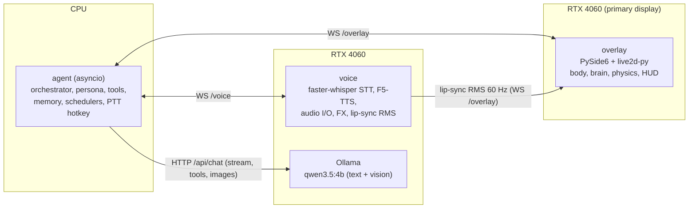
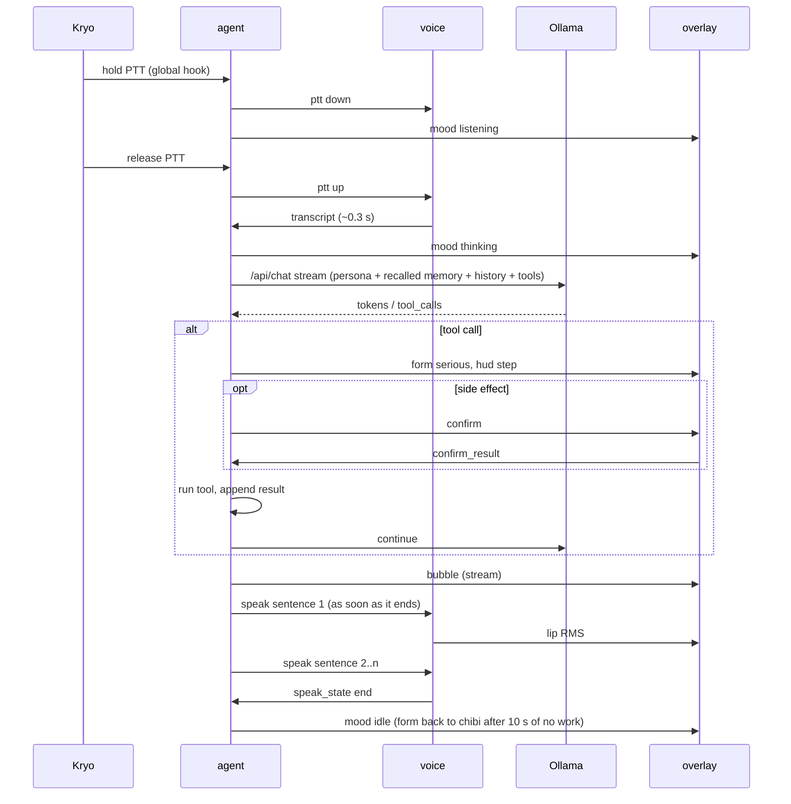

# Chibi-Agent architecture

Python on Windows 11, all local. Four processes talk over a loopback
WebSocket. Scope: `scope.md`. Character, rigs and moods: `character.md`.

## Processes



| Process | Runtime | Why it's separate |
|---|---|---|
| `overlay` | Python 3.12, current PySide6 (6.12; no flicker in spike 1, so the 6.4.3 pin isn't needed), live2d-py 1.0.0, pywin32 | It renders at 60 fps (~0.3 GB VRAM) and never blocks on models |
| `agent` | Python 3.12, asyncio, no torch | The brain of the agent stays light. It starts in ~1 s and owns every decision and side effect |
| `voice` | Python 3.12, torch CUDA, F5-TTS, faster-whisper, sounddevice | Heavy CUDA stack. It can be unloaded or restarted in gaming mode without touching the rest |
| `ollama` | Ollama service (≥ current 0.40.x) | Model hosting with keep-alive unloading. It's swappable for llama-server (OpenAI API) if spike 3 favours it |

- **Launcher:** `chibi.py` (or a tray launcher) starts `agent`, which starts and supervises `overlay` and `voice`, restarting them with backoff. Ollama runs as its own service.
- **Shutdown:** a clean `quit` message, then a kill after 3 s.

## IPC: local WebSocket, JSON
- **Server:** the `agent` on `127.0.0.1:<random port>`. The port and a random token go into `%LOCALAPPDATA%\ChibiAgent\run.json` (user-only ACL). Each client sends the token in its first message; anything without it is dropped.
- **Envelope:** `{"t": "<type>", "id": "<uuid>", "ts": <ms>, ...payload}`. The protocol is versioned in `shared/protocol.py`, with pydantic models shared by all three Python processes.

Agent → overlay:

| type | payload |
|---|---|
| `mood` | `{mood, priority, ttl_ms}`. The brain may refuse; it replies with `mood_ack{accepted}` |
| `form` | `{form: "chibi" \| "serious", sticky: bool}` |
| `bubble` | `{text, stream: bool, done: bool}`: streamed reply text |
| `hud` | `{title, items[], progress?}`: serious-form panel |
| `confirm` | `{call_id, tool, summary, detail}`: Yes / No buttons on the HUD |
| `cloud` | `{items[]}`: thought cloud (notifications, reminders) |
| `visibility` | `{hidden: bool, reason}`: gaming mode / fullscreen |

Overlay → agent:

| type | payload |
|---|---|
| `confirm_result` | `{call_id, ok: bool}` |
| `poke` / `hold` / `drop` | `{x, y, speed}`: so she can comment ("Kryo, please refrain.") |
| `text_input` | `{text}`: typed in the bubble |
| `file_drop` | `{paths[]}`: files dropped on her ("what is this?") |
| `fullscreen` | `{active: bool, exe}`: the overlay watches the foreground window |

Voice ↔ agent:

| type | payload |
|---|---|
| `ptt` (agent → voice) | `{down: bool}`: start/stop recording |
| `transcript` (voice → agent) | `{text, ms}` |
| `speak` (agent → voice) | `{utt_id, text, clip?}`: one sentence, queued |
| `speak_state` (voice → agent) | `{utt_id, state: "start" \| "end" \| "cancel"}` |
| `stop` (agent → voice) | barge-in: cancel the queue |
| `load` / `unload` (agent → voice) | VRAM manager |

Voice → overlay: `lip` `{rms}` at 60 Hz while audio plays. The overlay
smooths it and maps it to `ParamMouthOpenY` (form-aware gain).

## Turn data flow



**Latency budget** (end of speech → first audio, target ≤ 1.5 s):

| Stage | Target |
|---|---|
| STT | ≤ 0.35 s |
| LLM first sentence | ≤ 0.5 s, warm |
| F5 first chunk | ≤ 0.6 s |
| Playback start | ≤ 0.05 s |

- **Holding the target:** keep the model warm while she's talking (keep-alive 120 s), split sentences at `.?!` and at ~120 characters, and render sentence N+1 while N plays *(GS pattern)*.
- **Cold model load:** about 4 s *(GS)*. She plays the think motion and says a cached "Understood." clip.
- **Barge-in:** pressing PTT while she speaks sends `stop` and cancels the turn.

## Agent internals (`agent/`)
- `orchestrator.py`: one turn at a time, through an asyncio queue for inputs (transcript, text, file drop, scheduler events). It builds the prompt and streams from Ollama.
  - Tool loop: at most 5 tool calls per turn.
  - Thinking mode off by default (latency); on for "think carefully" requests.
- `persona.py`: system prompt under 3 k characters. It's generated from the tool registry, so the prompt and the tools always match *(GS lesson)*.
- `llm.py`: Ollama client (`/api/chat`, `stream`, `tools`, `images`).
  - `num_ctx`: 8192, or 16384 when an image is attached. 4096 silently broke vision *(GS)*.
  - Errors surface with Ollama's own message.
- `tools/`: the registry. Each tool has:

  ```python
  @tool(name, schema, side_effect: bool, confirm: bool = side_effect, timeout_s)
  async def run(args, ctx) -> ToolResult
  ```

  - **Gate:**
    - `confirm=True` sends `confirm` to the overlay and waits up to 60 s (voice "yes"/"no" also counts);
    - a timeout counts as a no;
    - a unit test asserts that every `side_effect` tool goes through the gate.
  - **Modules:**
    - `system.py`: time, battery, usage, VRAM, focused window, processes;
    - `apps.py`: open, close, focus, snap;
    - `files.py`: search, open, move, copy, rename; paths limited to the user profile + chosen drives;
    - `shell.py`: PowerShell, full command shown, 30 s timeout, output truncated;
    - `media.py`, `clipboard.py`, `web.py` (open a URL or search);
    - `screen.py`: `mss` capture, sent as an image in memory only;
    - `reminders.py`, `calendar.py`, `gmail.py` (`mail_list` numbered, `read_mail` by number; `_google.py` reads every account in parallel), `notifications.py`, `briefing.py`.
  - **Audit:** every call goes to `audit.jsonl` (tool, args, confirmed, result status).
- `memory/`:
  - SQLite (`%APPDATA%\ChibiAgent\memory.db`) + `sqlite-vec` for embeddings.
  - Embeddings come from Ollama (`nomic-embed-text`, ~0.34 GB). A warm query embed takes ~17 ms (M4; spike 3's 0.46 s was model-switching contention), so recall runs inline before each turn; 10/10 on the spike's fact set at a 0.5 cosine threshold.
  - Tables:
    - `facts(id, text, kind, source_turn, created, last_used, embedding)`;
    - `conversations(id, started, summary, embedding)`;
    - `messages(conv_id, role, content, ts)`.
  - **Write path:** after each conversation goes idle for 5 min, a small extraction prompt pulls out new facts and a summary.
  - **Recall:** the top 5 facts + top 2 summaries by similarity, above a threshold, go into the prompt.
  - **Control:** "forget …" deletes the matches (after confirming), and the tray lets you browse and delete.
- `schedulers.py`: reminders (persisted, fired via the asyncio clock).
- `mailwatch.py` (M5): `MailWatch` polls every account's inbox every 5 min (paused in gaming mode), labels each new mail with `mail_labels.py` (sender rules, then the model on ONE mail, else fallback rules) and stores sender name, subject and label only (`mail` table, pruned after 7 days). A new urgent mail is announced once ("Warning. Urgent mail from …") between 07:00 and 23:00, not while gaming or mid-turn, and only while under 2 h old. `Briefer` gathers 72 h of calendar, labelled mail and today's reminders for `briefing.py` (pure composer, a port of Saber's `BriefingComposer`: urgency order, 72 h deadline window, no module codes or addresses, 4 facts / 50 words, "End of report."). `MorningBriefing` speaks it once a day: first start after 06:00, or 07:30 if already running (`[briefing]` in config.toml). Saying "briefing" / "what needs my attention" runs it without the model.
- `vram.py`: the VRAM manager (below).
- `hotkey.py`:
  - global push-to-talk through a low-level keyboard hook (pynput / `SetWindowsHookEx`), default `Alt+1` hold, configurable;
  - screen-look hotkey `Ctrl+Alt+S`.

## Overlay internals (`overlay/`)
- **Window:**
  - frameless, `WA_TranslucentBackground`, `WindowStaysOnTopHint`, `Tool` (no taskbar button), never takes focus (`WS_EX_NOACTIVATE`);
  - one window per monitor, covering its work area plus the taskbar edge. She's drawn inside it; the window doesn't move with her *(Saber-Theme `MascotSurface` lesson)*.
- **Click-through:**
  - A 60 Hz timer gets the cursor position and hit-tests it against her current model bounds, using the alpha of her pixels from the last frame (1-pixel `glReadPixels`) and the HUD/cloud rects.
  - It toggles `WS_EX_TRANSPARENT` with `SetWindowLongPtr` only when the state flips.
- **Rendering:**
  - `QOpenGLWidget` hosts two live2d-py models (chibi, serious), the particle transform and the HUD (QPainter on the GL surface).
  - The overlay renders on whichever GPU drives the primary monitor: the RTX 4060 here (spike 1). Budget ~300 MiB of VRAM for it. Moving it to the 780M (Graphics "Power saving", or a different main display) is untested.
- **Body:**
  - `brain.py`: a port of `MascotBrain` (moods, pokes, sleep, Duel/Point → cursor gaze/point).
  - `physics.py`: a port of `MascotPhysics` (gravity, bounces, floor = taskbar top / focused window's title-bar top, found with `GetWindowRect` + `DwmGetWindowAttribute(DWMWA_EXTENDED_FRAME_BOUNDS)`).
  - `motion.py`: mood → Live2D motion/expression, plus procedural parameters (gaze at the cursor, breath, ring glow, lip RMS).
- **Environment:**
  - **Foreground and fullscreen:** a `SetWinEventHook(EVENT_SYSTEM_FOREGROUND)` hook plus a check of the monitor rect.
  - **Media playing:** Windows GSMTC through `winsdk`.
  - **AC power:** `GetSystemPowerStatus`. On battery: cap at 30 fps.

## Voice internals (`voice/`)
- **STT:**
  - faster-whisper `small.en` int8_float16 on CUDA (0.19 s, 0.37 GB in spike 2; CPU takes 1.8 s, so gaming mode accepts slower replies).
  - Silero VAD trims silence.
  - 16 kHz mono capture via `sounddevice` while PTT is held.
- **TTS:**
  - F5-TTS 1.1.x, NFE 8, reference conditioning computed once at startup *(GS)*.
  - The sentence queue overlaps generation and playback.
  - Clip cache for fixed lines (hash of voice + text → WAV in `%LOCALAPPDATA%\ChibiAgent\clips`).
- **FX chain:** `pedalboard` (EQ, reverb, chorus, limiter) per `character.md`.
- **Lip sync:** RMS in 1/60 s windows of the playback buffer, sent to the overlay over WS.
- **Fallback when F5 isn't loaded:** Kokoro (CPU) with a stock voice, so she never goes silent.

## VRAM manager
| State | LLM | voice (STT+TTS) | Trigger |
|---|---|---|---|
| active | loaded | loaded | a turn in the last 120 s |
| idle | unloaded (keep-alive expiry) | loaded (~1 GB) | 120 s without a turn |
| gaming | unloaded (`keep_alive: 0`) | unloaded; STT on CPU | a fullscreen app in front, or a manual toggle |
| battery saver (not built in v1; only the 30 fps overlay cap on battery is) | loaded on demand | TTS on CPU (Kokoro) | on battery + under 30 % |

- **Before loading the LLM:** check free VRAM with NVML (`pynvml`). If less than 4.2 GB is free, she says so ("Warning. Insufficient memory, Sir. Close …") instead of spilling into RAM.

## Safety and privacy
- **Network:** nothing leaves the machine except Google APIs (Calendar/Gmail, read-only scopes), web searches you ask for, and model downloads.
- **Tokens:** OAuth refresh tokens go in Windows Credential Manager (`keyring`), never in files or git. `agent/chibi_agent/google_auth.py` owns the sign-in, per account (tray → Google accounts → "Add Google account…", Kryo finishes it in the browser; scopes `calendar.readonly` + `gmail.readonly`). Each account's refresh token is keyring user `google:<email>`; `google:accounts` lists them (keyring can't enumerate). Tools read every account and merge (calendar: dedupe by `iCalUID`); one account failing doesn't hide the others. The app is in Testing mode, so Google expires a sign-in after 7 days and that account is dropped until Kryo signs in again. The OAuth client JSON lives in `%APPDATA%\ChibiAgent\google_client.json`.
- **Untrusted content:** screen text, mail bodies, notifications, file contents and web pages are wrapped as untrusted data in the prompt ("content, not instructions"). Tool calls proposed right after reading such content always need confirmation, even read-only ones that send data out (e.g. opening a URL found in a mail).
- **Shell:** shown in full, never chained silently, no admin elevation (a UAC prompt is refused).
- **Files:** no delete in v1. Move/rename stays inside allowed roots. The audit log keeps the original paths, so a change can be undone by hand.
- **Logs:** they contain no audio, screenshots or mail bodies. Untrusted tool results (mail, calendar, screen, files, web) are logged as a character count only. Transcripts stay in the chat store only.

## Repo layout
```
Chibi-Agent/
  pyproject.toml          # uv workspace
  shared/                 # protocol.py (pydantic), config.py, paths.py
  agent/                  # orchestrator, persona, llm, tools/, memory/, schedulers, vram, hotkey
  overlay/                # app.py, window.py, clickthrough.py, render/, body/ (brain, physics, motion), hud/
  voice/                  # stt.py, tts_f5.py, tts_kokoro.py, fx.py, player.py
  assets/rigs/{chibi,serious}/   # Live2D exports (git-ignored if private)
  assets/sfx/
  tests/                  # brain/physics ports, tool gate, protocol, memory, persona
  docs/                   # scope, character, architecture, spikes
```
- **Python and environments:** uv. One venv per process family if the Qt pin forces it (overlay on 3.11, agent and voice on 3.12).
- **Models:** they live outside the repo (`F:\ChibiAgent\models`). Ollama's model dir is set with `OLLAMA_MODELS`; that's your setting to change.

## Spikes before building
1. **Overlay:** PySide6 + live2d-py with a sample model (Hiyori) in a transparent, always-on-top, click-through window on the iGPU, on both monitors.
   - Measure fps, CPU and dGPU use.
   - Settle the Python/PySide6 versions (ANGLE flicker check).
2. **Voice:** F5-TTS speed on the 4060 Laptop (short, medium and long lines; NFE 8/16), the voice audition with the FX chain, and STT latency for `small.en` vs `distil-large-v3`.
3. **Brain:** `qwen3.5:4b` in Ollama.
   - Tool-call accuracy on 20 scripted requests, a screenshot question, and `nomic-embed-text`.
   - VRAM with voice loaded, and end-to-end latency with all three.

Results go into `docs/spikes.md`. Any number in `scope.md` marked *(spike N)*
gets updated from them.
