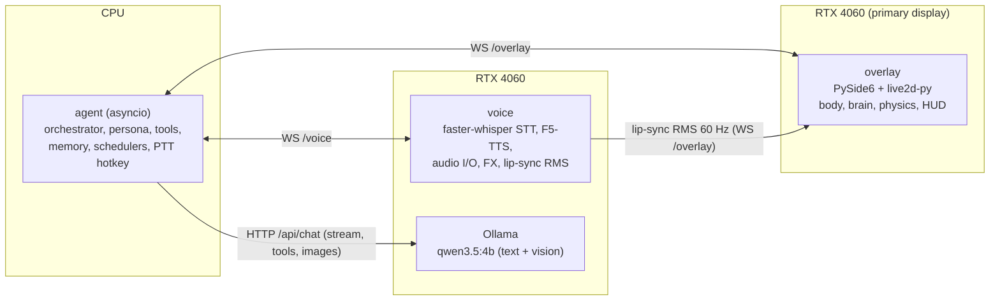
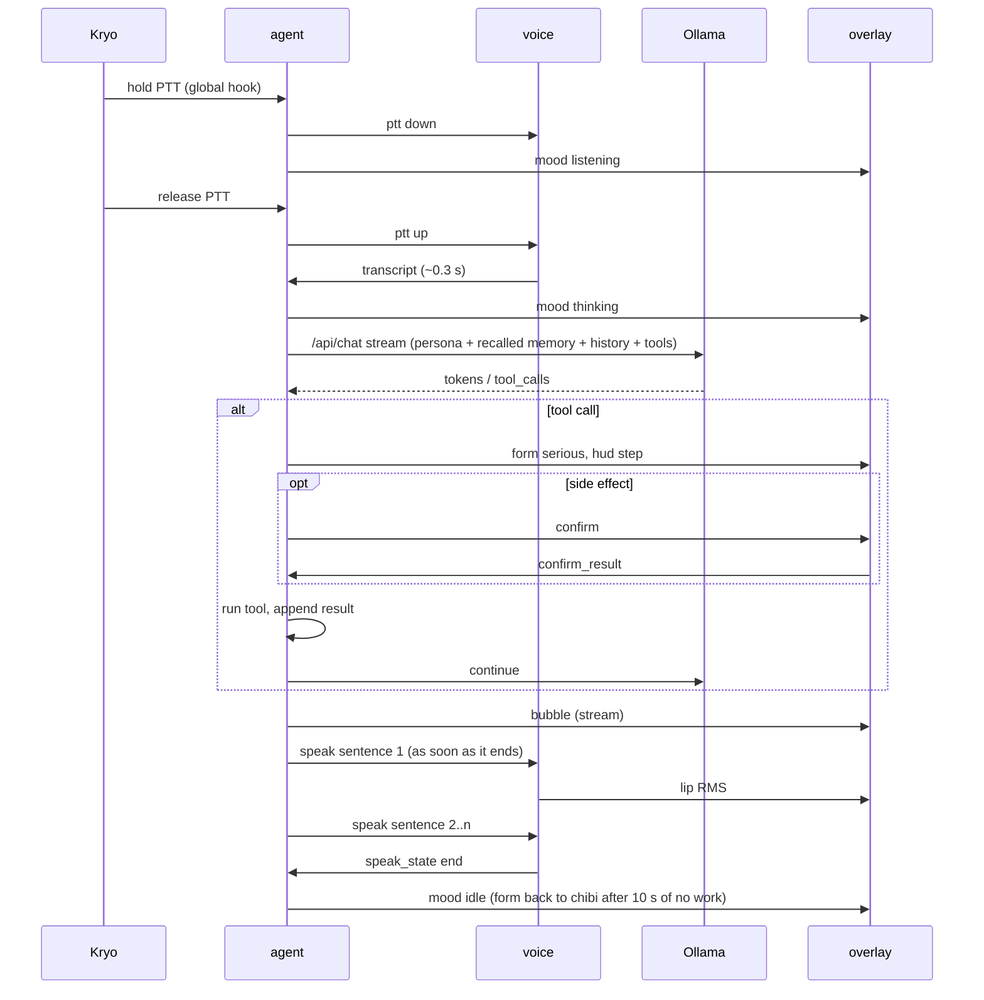

# Chibi-Agent architecture

Python on Windows 11, all local. Four processes talk over a loopback
WebSocket. Scope: `scope.md`. Character, rigs and moods: `character.md`.

## Processes



| Process | Runtime | Why it's separate |
|---|---|---|
| `overlay` | Python 3.12, current PySide6 (6.12; no flicker in spike 1, so the 6.4.3 pin isn't needed), live2d-py 1.0.0, pywin32 | It renders at 60 fps (~0.3 GB VRAM) and never blocks on models |
| `agent` | Python 3.12, asyncio, no torch | The brain of the agent stays light. It starts in ~1 s and owns every decision and side effect |
| `voice` | Python 3.12, torch CUDA, F5-TTS, faster-whisper, sounddevice | Heavy CUDA stack. It can be unloaded or restarted in gaming mode without touching the rest |
| `ollama` | Ollama service (≥ current 0.40.x) | Model hosting with keep-alive unloading. It's swappable for llama-server (OpenAI API) if spike 3 favours it |

- **Launcher:** `chibi.py` (or a tray launcher) starts `agent`, which starts and supervises `overlay` and `voice`, restarting them with backoff. Ollama runs as its own service.
- **Shutdown:** a clean `quit` message, then a kill after 3 s.

## IPC: local WebSocket, JSON
- **Server:** the `agent` on `127.0.0.1:<random port>`. The port and a random token go into `%LOCALAPPDATA%\ChibiAgent\run.json` (user-only ACL). Each client sends the token in its first message; anything without it is dropped.
- **Envelope:** `{"t": "<type>", "id": "<uuid>", "ts": <ms>, ...payload}`. The protocol is versioned in `shared/protocol.py`, with pydantic models shared by all three Python processes.

Agent → overlay:

| type | payload |
|---|---|
| `mood` | `{mood, priority, ttl_ms}`. The brain may refuse; it replies with `mood_ack{accepted}` |
| `form` | `{form: "chibi" \| "serious", sticky: bool}` |
| `outfit` | `{outfit}`: change into another outfit (a name from `outfit_state.outfits`); form, mood and facing stay. The overlay answers with `outfit_state` |
| `bubble` | `{text, stream: bool, done: bool}`: streamed reply text |
| `hud` | `{title, items[], progress?}`: serious-form panel |
| `confirm` | `{call_id, tool, summary, detail}`: Yes / No buttons on the HUD |
| `cloud` | `{items[]}`: thought cloud, newest first; for now the ≤3 unbriefed urgent/reply notifications as "App: title" (`notifywatch.py`), `[]` clears it |
| `visibility` | `{hidden: bool, reason}`: gaming mode / fullscreen |
| `state` | `{muted, gaming, autostart, google_accounts[], notif_access}`: the tray's check marks; on connect and on every change |
| `memory_items` | `{items: [(id, text)]}`: the tray's memory list |

Overlay → agent:

| type | payload |
|---|---|
| `confirm_result` | `{call_id, ok: bool}` |
| `poke` / `hold` / `drop` | `{x, y, speed}`: so she can comment ("Kryo, please refrain.") |
| `react` | `{event, picked}`: a body event (poke, held, drop, dizzy, sleep, stretch, a wheel pose...). The agent (`reactions.py`) may answer with `speak {clip, only_cached}`; the voice plays the cached clip or skips it. `react-` utterances never send her `idle`. |
| `text_input` | `{text}`: typed in the bubble |
| `file_drop` | `{paths[]}`: files dropped on her ("what is this?") |
| `fullscreen` | `{active: bool, exe}`: the overlay watches the foreground window |
| `outfit_state` | `{outfit, outfits[], ok: bool, error}`: what she wears and can wear. Sent on connect, after each change, and as the refusal of a bad `outfit` (`ok: false`, unknown name, missing model file or bad map). The agent keeps it in `Controller.outfit` / `.outfits` |
| `command` | `{name, arg}`: a tray or Customize action (`CommandName` in `protocol.py`): show/hide, mute, gaming, memory list/delete, autostart, Google sign-in/out, notification access, `restart`, `voice_test` (arg: a line to say), `quit` |
| `voice_tune` | `{engine: "f5" \| "kokoro", voice, speed, nfe}`: the voice picked in Customize. The agent relays it to the voice process and resends the last one when voice reconnects |

Voice ↔ agent:

| type | payload |
|---|---|
| `ptt` (agent → voice) | `{down: bool}`: start/stop recording |
| `transcript` (voice → agent) | `{text, ms}` |
| `speak` (agent → voice) | `{utt_id, text, clip?, only_cached}`: one sentence, queued. `only_cached` (reactions): play the clip if it's rendered, else skip |
| `speak_state` (voice → agent) | `{utt_id, state: "start" \| "end" \| "cancel"}` |
| `stop` (agent → voice) | barge-in: cancel the queue |
| `load` / `unload` (agent → voice) | `{what: stt \| tts \| all, reason}`: VRAM manager; `reason: "memory"` (memory relief) drops F5 only, and it reloads by itself when speech needs it |
| `voice_tune` (agent → voice) | relayed from the overlay (above) |

Voice → overlay: `lip` `{rms}` at 60 Hz while audio plays. The overlay
smooths it and maps it to `ParamMouthOpenY` (form-aware gain).

## Turn data flow



**Latency budget** (end of speech → first audio, target ≤ 1.5 s):

| Stage | Target |
|---|---|
| STT | ≤ 0.35 s |
| LLM first sentence | ≤ 0.5 s, warm |
| F5 first chunk | ≤ 0.6 s |
| Playback start | ≤ 0.05 s |

- **Holding the target:** keep the model warm while she's talking (keep-alive 120 s), split sentences at `.?!` and at ~120 characters, and render sentence N+1 while N plays *(GS pattern)*.
- **Cold model load:** about 4 s *(GS)*. She plays the think motion and says a cached "Understood." clip.
- **Barge-in:** pressing PTT while she speaks sends `stop` and cancels the turn.

## Agent internals (`agent/`)
- `orchestrator.py`: one turn at a time, through an asyncio queue for inputs (transcript, text, file drop, scheduler events). It builds the prompt and streams from Ollama.
  - Tool loop: at most 5 tool calls per turn.
  - Thinking mode off by default (latency); on for "think carefully" requests.
  - Tool selection (`tools/select.py`): the turn's text is embedded once, and that vector also feeds memory recall.
    - Only the top 3 tool *families* go to the model, so mail_list keeps read_mail and search_files keeps move_file.
    - Three tools are always sent: look_at_screen, remember and open_app. The families of tools used in the last 2 turns are sent too.
    - When unsure, or when the embedding fails, she gets every tool.
    - If she says she can't do something while she only had a subset, the step reruns once with every tool.
    - `[tools] select = false` turns selection off.
- `persona.py`: system prompt under 3,400 characters (raised from 3,000 for the script tools; `test_tools.py` and `test_gmail.py` check it). It's generated from the tool registry, so the prompt and the tools always match *(GS lesson)*.
- `llm.py`: Ollama client (`/api/chat`, `stream`, `tools`, `images`).
  - `num_ctx`: 8192, or 16384 when an image is attached. 4096 silently broke vision *(GS)*.
  - Errors surface with Ollama's own message.
- `tools/`: the registry. Each tool has:

  ```python
  @tool(name, schema, side_effect: bool, confirm: bool = side_effect, timeout_s)
  async def run(args, ctx) -> ToolResult
  ```

  - **Gate:**
    - `confirm=True` sends `confirm` to the overlay and waits up to 60 s (voice "yes"/"no" also counts);
    - a timeout counts as a no;
    - a unit test asserts that every `side_effect` tool goes through the gate.
  - **Modules:**
    - `system.py`: time, battery, usage, VRAM, focused window, processes;
    - `apps.py`: open, close, focus, snap;
    - `files.py`: search, open, move, copy, rename; `grep_files` (text inside files), `list_folder` (size sort totals subfolders), `read_file`, and confirmed `create_folder` / `create_file` (never overwrite); paths limited to `allowed_roots` (user profile + chosen drives); file contents are untrusted;
    - `recycle_bin.py`: `recycle_bin` lists it (read-only); `recycle_bin_action` opens it or restores an item (confirmed), through the Shell namespace. There's no empty action (v1 doesn't delete): she opens the bin and Saber empties it;
    - `network.py`: read-only `network` (connections by process, traffic rates, ping, Wi-Fi via psutil, ping, netsh);
    - `memory_tools.py`: `remember`, `recall_memory`, `forget_memory`, `set_reminder`, `list_reminders`, `cancel_reminder` (the writes ask first);
    - `shell.py`: PowerShell, full command shown, 30 s timeout, output truncated; `Clear-RecycleBin` is blocked;
    - `media.py`, `clipboard.py`, `web.py` (open a URL or search);
    - `screen.py`: `mss` capture, sent as an image in memory only;
    - `reminders.py`, `calendar.py`, `gmail.py` (`mail_list` numbered, `read_mail` by number; `_google.py` reads every account in parallel), `briefing.py`. Windows notifications have no tool in v1 (the prompt budget); `notifywatch.py` feeds them to the briefing.
  - **Audit:** every call goes to `audit.jsonl` (tool, args, confirmed, result status).
- `memory/`:
  - SQLite (`%APPDATA%\ChibiAgent\memory.db`) + `sqlite-vec` for embeddings.
  - Embeddings come from Ollama (`nomic-embed-text`, ~0.34 GB). A warm query embed takes ~17 ms (M4; spike 3's 0.46 s was model-switching contention), so recall runs inline before each turn; 10/10 on the spike's fact set at a 0.5 cosine threshold.
  - Tables:
    - `facts(id, text, kind, source_turn, created, last_used, embedding)`;
    - `conversations(id, started, summary, embedding)`;
    - `messages(conv_id, role, content, ts)`.
  - **Write path:** after each conversation goes idle for 5 min, a small extraction prompt pulls out new facts and a summary.
  - **Recall:** the top 5 facts + top 2 summaries by similarity, above a threshold, go into the prompt.
  - **Control:** "forget …" deletes the matches (after confirming), and the tray lets you browse and delete.
- `schedulers.py`: reminders (persisted, fired via the asyncio clock).
- `mailwatch.py` (M5): `MailWatch` polls every account's inbox every 5 min (paused in gaming mode), labels each new mail with `mail_labels.py` (sender rules, then the model on ONE mail, else fallback rules) and stores sender name, subject and label only (`mail` table, pruned after 7 days). A new urgent mail is announced once ("Warning. Urgent mail from …") between 07:00 and 23:00, not while gaming or mid-turn, and only while under 2 h old. `Briefer` gathers 72 h of calendar, labelled mail and today's reminders for `briefing.py` (pure composer, a port of Saber's `BriefingComposer`: urgency order, 72 h deadline window, no module codes or addresses, 4 facts / 50 words, "End of report."). `MorningBriefing` speaks it once a day: first start after 06:00, or 07:30 if already running (`[briefing]` in config.toml). Saying "status report" (or "report", "briefing", "what needs my attention") runs it without the model; the HUD calls it a status report.
- `notifywatch.py`: `NotifyWatch` reads Windows toasts with WinRT `UserNotificationListener` once Kryo allows it (tray → Allow notification access; denied opens `ms-settings:privacy-notifications`). The change event needs package identity, so it polls every 60 s on a worker thread: a listing takes 6–9 s (Spike 4). It skips `ignore_apps`, toasts from before start − 2 h, and gaming/mid-turn. It labels like mail (`mail_labels`, kind "notification", ≤5 by the model per poll, then rules) and stores app, first line and label only (`notif` table, 2 days). It never speaks unasked; urgent/reply toasts go to the `cloud` message and the briefing (`[notifications]` in config.toml).
- `vram.py`: the VRAM manager (below).
- `memrelief.py`: memory relief (`[memory_relief]` in config.toml). RAM is sampled every 20 s. It goes "high" after 2 samples ≥ 90 % and stays high until it drops under 85 %, with at most one intervention per 10 min. Each intervention:
  - is skipped mid-turn and in gaming mode;
  - stops early once RAM is under threshold − 5 %;
  - logs every decision (`memrelief: ...`);
  - reports on the HUD ("Memory relief"), in the bubble and in her voice. If F5 was just dropped, only the "Notice." clip is spoken.

  The stages, cheapest first:
  1. Her own stack: F5 goes after 180 s of quiet, but only when F5 is the voice in use. The voice process gets `load{unload, tts, reason: "memory"}` and reloads F5 by itself for the next sentence; PTT reloads it too. Kokoro stays. Her Ollama models (chat, and the embed model's ~1.2 GB runner, kept alive 30 min) are unloaded with `keep_alive: 0` after 60 s without a turn.
  2. `EmptyWorkingSet` on Kryo's idle apps with a working set ≥ 300 MB, and on her quiet voice process (its working set is mostly cuBLAS/CUDA DLL pages). This is low value: the pages fault back in.
  3. The largest idle app (≥ 700 MB, with a window) is named and offered through the confirmation gate. A yes posts WM_CLOSE (never a kill); a no keeps it quiet for an hour.

  It never touches system processes, other users' processes, the Claude app (and its WebView2), the foreground app or her own processes, and it never purges the standby list. Debug: `python -m chibi_agent.memrelief --once` (a dry run; `--act` acts but only logs its messages).
- `reactions.py`: answers the overlay's `react` events with cached voice clips (gates and cooldowns: `character.md` → Sounds).
- **Restart** (tray → Restart agent, `command restart`): the agent quits cleanly, then starts a fresh agent, which restarts the overlay and voice. It leaves its job object with `CREATE_BREAKAWAY_FROM_JOB`; when the job forbids that, it starts the new agent through WMI (`Win32_Process.Create`), since a process WMI creates belongs to no job of ours (`main.py`).
- **Fresh memory:** `tools/reset_memory.py` (run with Raphael quit and Ollama up) backs up `memory.db` to `memory.db.bak-<date-time>`, clears facts, conversations and messages, and loads starting facts from `ChibiAgent\profile.txt` (outside git). Reminders, mail/notification labels and settings stay.
- `hotkey.py`:
  - global push-to-talk through a low-level keyboard hook (pynput / `SetWindowsHookEx`), default `Alt+1` hold, configurable;
  - screen-look hotkey `Ctrl+Alt+S`.

## Overlay internals (`overlay/`)
- **Window:**
  - frameless, `WA_TranslucentBackground`, `WindowStaysOnTopHint`, `Tool` (no taskbar button), never takes focus (`WS_EX_NOACTIVATE`);
  - one window per monitor, covering its work area plus the taskbar edge. She's drawn inside it; the window doesn't move with her *(Saber-Theme `MascotSurface` lesson)*.
- **Click-through:**
  - A 60 Hz timer gets the cursor position and hit-tests it against her current model bounds, using the alpha of her pixels from the last frame (1-pixel `glReadPixels`) and the HUD/cloud rects.
  - It toggles `WS_EX_TRANSPARENT` with `SetWindowLongPtr` only when the state flips.
- **Rendering:**
  - `QOpenGLWidget` hosts two live2d-py models (chibi, serious) of the current outfit, the particle transform and the HUD (QPainter on the GL surface).
  - The overlay renders on whichever GPU drives the primary monitor: the RTX 4060 here (spike 1). Budget ~300 MiB of VRAM for it. Moving it to the 780M (Graphics "Power saving", or a different main display) is untested.
- **Bodies** (2D art / 3D model, one at a time; tray or Customize switches, `[overlay] bodies`): the 3D body is an outfit whose rig is `godot:<overlay3d dir>`. `godot3d.py`'s `GodotModel` takes the puppet calls and streams one frame per tick (feet, height, clip, expression, params, gaze) over local TCP to a Godot renderer (`overlay3d/`). The overlay owns the renderer's window: it sits under the overlay window, click-through and unfocusable, 1 px short of fullscreen. The renderer sends back a hull for hit tests. Input, brain, physics and panels are unchanged. Details and budgets: `overlay3d/README.md`.
- **Outfits** (`outfits.py`, docs/character.md → Outfits): one exported model per outfit and form.
  - Config: `[overlay] outfit = "robe"` picks the current one; `[overlay.outfits.<name>]` has `chibi_rig` / `serious_rig` (`.model3.json`) and optional `chibi_map` / `serious_map`, which default to the shared `[overlay] chibi_map` / `serious_map` (relative to `overlay/`). Old configs with only `[overlay] chibi_rig` / `serious_rig` still work as one outfit, `default`; next to an `outfits` table those keys only fill an outfit's missing rig. An unknown `outfit` falls back to the first one; an outfit without a rig or map stops the overlay at start.
  - Switching: an `outfit` message or tray → Outfit. The stage checks the name, the model files and the maps first (refusals go back as `outfit_state ok=false`), then plays the transform particle puff without changing form; at its midpoint it swaps the maps and model paths and bumps `outfit_gen`, and the window reloads both puppets in its GL context and re-measures them. Brain, physics, form and facing are untouched. The choice lasts until restart (the config holds the start outfit).
  - Outfits in `config.toml` (2026-10-27): `casual_coat` (the start outfit: the sprite-pack chibi), `robe` (her own Live2D chibi rig v21), `aniya` (a translated free Live2D model), `teen_3d` and `teen_3d_ruby` (the 3D body), `coat` (the Haru/Mao samples swapped). Every 2D outfit's serious form is still the Mao sample: her own serious rig doesn't exist yet.
- **Rig kinds** (the outfit's rig path picks what `Puppet` drives; every kind answers the same live2d-py calls):
  - a `.model3.json`: a Live2D model (live2d-py);
  - `sprites:<pack dir>` (`sprites.py`, `rigs/raphael_sprites.toml`): Saber's drawn image pack (casual coat). Expressions are whole images; lip sync and blink come from registered states (a feathered mouth patch on other expressions); 18 motion groups map to poses and short sequences (the 8-frame walk, the two dance cycles), each pose placed by its own feet on the master's baseline; eye follow uses the 8-direction gaze drawings clipped to the eye rectangles. Sit and Sleep sit on the slime; the sword is worn at her hip (Look toggle) and held when alert. This is the chibi she wears by default (`casual_coat`);
  - `vector:` (`vector/`): a code-drawn rig, kept behind the same seam but unused;
  - `godot:<dir>[#file.vrm]`: the 3D body (below).
- **Customize window** (tray → Customize Raphael, `customize.py`): a live preview and tabs for what each mood and idle moment plays, the look (outfit, height, walking pace, body, panel font and size; "Add font file…" copies it into `[overlay] fonts_dir`), behaviour (eye follow: last click / pointer / straight ahead, blink, idle moments, sleep, effects, extra EDM words), sprite sequences (frames, timing, what she holds and sits on) and voice (F5 with any reference clip, or one of Kokoro's 54 voices; a test line). Apply changes her live; Save writes `%APPDATA%\ChibiAgent\character.toml` (`character.py`), loaded at startup and kept apart from the hand-edited `config.toml`.
- **Panels** (`hud.py`, `core_fx.py`):
  - Thinking and speaking show a geodesic wire core above her head: it spins with shards spiralling in while she thinks, and grows and brightens with her voice while she speaks. Voice reactions don't show it.
  - Her words go in a frosted liquid-glass panel beside her at face height (her right, or her left near the screen edge; 20 % teal wash), in Electroharmonix (then OCR A Extended, Consolas). Fonts in `[overlay] fonts_dir` are loaded for the overlay only; the font files stay outside git.
  - The old "…" text cloud is gone. The `cloud` message (notifications) isn't drawn yet.
- **Pose wheel** (`wheel.py`): right-click her for a frosted-glass wheel of 8 poses (Wave, Cheer, Think, Look around, Stretch, Dance, Sit, Sleep); `Brain.perform` plays the pick. Details: `handoffs/pose-wheel-and-3d-polish.md`.
- **Home spot:** Alt+drag sets where she returns to on the taskbar (saved as `home_x`/`home_y` in `character.toml`).
- **Gaze:** her eyes look where Saber last clicked (any button, anywhere) for a few seconds, then ahead; a pointer resting near her gets one 2.5 s smile.
- **Sounds** (`sounds.py`): UI sounds for startup, reappearing and the wheel (`character.md` → Sounds).
- **Body:**
  - `brain.py`: a port of `MascotBrain` (moods, pokes, sleep, Duel/Point → cursor gaze/point).
  - `physics.py`: a port of `MascotPhysics` (gravity, bounces, floor = taskbar top / focused window's title-bar top, found with `GetWindowRect` + `DwmGetWindowAttribute(DWMWA_EXTENDED_FRAME_BOUNDS)`).
  - `motion.py`: mood → Live2D motion/expression, plus procedural parameters (gaze at the cursor, breath, ring glow, lip RMS).
- **Environment:**
  - **Foreground and fullscreen:** a `SetWinEventHook(EVENT_SYSTEM_FOREGROUND)` hook plus a check of the monitor rect.
  - **Media playing:** Windows GSMTC through `winsdk`, with the track (title, artist, album, genres, app). Players that publish no media session (classic VLC, MPC-HC/BE, mpv, PotPlayer, SMPlayer, KMPlayer, Windows Media Player) are caught by their sound instead: `audio_sessions.py` reads Windows' per-app audio meters (Core Audio through ctypes); a known player making sound counts as playing, held 5 s through quiet passages, and its window title gives the track.
  - **Dance style:** `body/music.py` calls a track "excited" (whole-word EDM keywords such as house, dubstep, nightcore, remix; known EDM artists/channels; an electronic genre; Saber's extra words from Customize) or "vibe". Excited plays `dancing_excited`, anything else the slow sway. Customize → Behaviour shows a Now playing line.
  - **AC power:** `GetSystemPowerStatus`. On battery: cap at 30 fps.

## Voice internals (`voice/`)
- **STT:**
  - faster-whisper `small.en` int8_float16 on CUDA (0.19 s, 0.37 GB in spike 2; CPU takes 1.8 s, so gaming mode accepts slower replies).
  - Its cuBLAS/cuDNN DLLs are loaded from torch's wheel without importing torch (`env.load_cuda_dlls`). Importing torch maps all of torch's CUDA libraries: measured 2.6 → 2.0 GB private and 1.0 → 0.7 GB working set for Whisper alone. Torch comes in only with F5.
  - Silero VAD trims silence.
  - 16 kHz mono capture via `sounddevice` while PTT is held.
- **TTS:**
  - F5-TTS 1.1.x, NFE 8, reference conditioning computed once at startup *(GS)*.
  - The sentence queue overlaps generation and playback.
  - Clip cache for fixed lines (hash of voice + text → WAV in `%LOCALAPPDATA%\ChibiAgent\clips`).
- **FX chain:** `pedalboard` (EQ, reverb, chorus, limiter) per `character.md`.
- **Lip sync:** RMS in 1/60 s windows of the playback buffer, sent to the overlay over WS.
- **Engines:** F5 (the default, `[voice] f5`) or Kokoro (`kokoro-onnx` on the CPU, 54 preset voices, model files in `ChibiAgent\models\kokoro`), picked in Customize (`voice_tune`). The fixed clips re-render per voice. Kokoro is also the fallback when F5 isn't loaded, so she never goes silent.
- **Start-up:** the last `voice_tune` is saved to `%LOCALAPPDATA%\ChibiAgent\voice_tune.json`, and the voice tunes to it before the first load (the overlay's tune arrives only ~15 s in, which used to load config.toml's F5 and then swap). `HF_HUB_OFFLINE=1` is set once F5, Vocos and Whisper are all cached (the Hub checks cost ~20 s of a cold start). Clips are keyed and rendered together on the TTS thread.
- **Text clean-up:** `tts.speakable` rewrites numbers (3.5 → "3 point 5", $4.99, 10:30), since both engines read "." as a full stop; short lines get room for their last sound, trimmed after.

## VRAM manager
| State | LLM | voice (STT+TTS) | Trigger |
|---|---|---|---|
| active | loaded | loaded | a turn in the last 120 s |
| idle | unloaded (keep-alive expiry) | loaded (~1 GB) | 120 s without a turn |
| gaming | unloaded (`keep_alive: 0`) | unloaded; STT on CPU | a fullscreen app in front, or a manual toggle |
| battery saver (not built in v1; only the 30 fps overlay cap on battery is) | loaded on demand | TTS on CPU (Kokoro) | on battery + under 30 % |

- **Before loading the LLM:** check free VRAM with NVML (`pynvml`). If less than 4.2 GB is free, she says so ("Warning. Insufficient memory, Sir. Close …") instead of spilling into RAM.

## Safety and privacy
- **Network:** nothing leaves the machine except Google APIs (Calendar/Gmail, read-only scopes), web searches you ask for, and model downloads.
- **Tokens:** OAuth refresh tokens go in Windows Credential Manager (`keyring`), never in files or git. `agent/chibi_agent/google_auth.py` owns the sign-in, per account (tray → Google accounts → "Add Google account…", Kryo finishes it in the browser; scopes `calendar.readonly` + `gmail.readonly`). Each account's refresh token is keyring user `google:<email>`; `google:accounts` lists them (keyring can't enumerate). Tools read every account and merge (calendar: dedupe by `iCalUID`); one account failing doesn't hide the others. The app is in Testing mode, so Google expires a sign-in after 7 days and that account is dropped until Kryo signs in again. The OAuth client JSON lives in `%APPDATA%\ChibiAgent\google_client.json`.
- **Untrusted content:** screen text, mail bodies, notifications, file contents and web pages are wrapped as untrusted data in the prompt ("content, not instructions"). Tool calls proposed right after reading such content always need confirmation, even read-only ones that send data out (e.g. opening a URL found in a mail).
- **Shell:** shown in full, never chained silently, no admin elevation (a UAC prompt is refused).
- **Files:** no delete in v1. Move/rename stays inside allowed roots. The audit log keeps the original paths, so a change can be undone by hand.
- **Logs:** they contain no audio, screenshots or mail bodies. Untrusted tool results (mail, calendar, screen, files, web) are logged as a character count only. Transcripts stay in the chat store only.

## Repo layout
```
Chibi-Agent/
  pyproject.toml          # uv workspace
  shared/                 # protocol.py (pydantic), config.py, paths.py
  agent/                  # orchestrator, persona, llm, tools/, memory/, schedulers, vram, hotkey
  overlay/                # app.py, window.py, clickthrough.py, render/, body/ (brain, physics, motion), hud/
  voice/                  # stt.py, tts_f5.py, tts_kokoro.py, fx.py, player.py
  assets/rigs/{chibi,serious}/   # Live2D exports (git-ignored if private)
  assets/sfx/
  overlay3d/              # Godot 4.7 renderer for the 3D body (README.md)
  tools/                  # reset_memory.py, make_rig_template.py, prepare_aniya.py
  spikes/                 # brain, notifications, overlay, voice, vrm
  tests/                  # brain/physics ports, tool gate, protocol, memory, persona
  docs/                   # scope, character, architecture, spikes
```
- **Python and environments:** uv. One venv per process family if the Qt pin forces it (overlay on 3.11, agent and voice on 3.12).
- **Models:** they live outside the repo (`D:\Projects\Chibi-Agent-Project\ChibiAgent\models`). Ollama's model dir is set with `OLLAMA_MODELS`; that's your setting to change.

## Spikes before building
1. **Overlay:** PySide6 + live2d-py with a sample model (Hiyori) in a transparent, always-on-top, click-through window on the iGPU, on both monitors.
   - Measure fps, CPU and dGPU use.
   - Settle the Python/PySide6 versions (ANGLE flicker check).
2. **Voice:** F5-TTS speed on the 4060 Laptop (short, medium and long lines; NFE 8/16), the voice audition with the FX chain, and STT latency for `small.en` vs `distil-large-v3`.
3. **Brain:** `qwen3.5:4b` in Ollama.
   - Tool-call accuracy on 20 scripted requests, a screenshot question, and `nomic-embed-text`.
   - VRAM with voice loaded, and end-to-end latency with all three.

Results go into `docs/spikes.md`. Any number in `scope.md` marked *(spike N)*
gets updated from them.
