# The 2D avatar

[Wiki home](README.md) · [3D avatar](3d-avatar.md) · [Forms, bodies and outfits](forms-and-bodies.md) · [Interactions](interactions.md)

Raphael's 2D body is her **chibi**: about 2.5 heads tall, full body, 320 DIPs from her feet to the top of her head (`height_dip` in the rig map; Customize → Look can change it). She stands on the taskbar or on the focused window's title bar, and walks, sits, sleeps, dances and gets thrown around there.

Since v0.1.1 the chibi she wears by default is Saber's **casual-coat art**, the chibi built on the `svg-rig` branch: drawn images driven as a sprite pack, with SVG effects. Her serious form in that outfit is the 3D body ([Forms, bodies and outfits](forms-and-bodies.md)).

## One seam, several kinds of rig
The overlay never talks to a rig directly. `Puppet` (`overlay/chibi_overlay/puppet.py`) makes live2d-py calls (`StartMotion`, `SetExpression`, `SetSaveParamById`, `SetScale`, `SetOffset`, `Drag`, `Update`, `Draw`), and every kind of rig answers them. The outfit's rig path picks the kind:

| Rig path | Kind | Code | Used now? |
|---|---|---|---|
| `sprites:<pack dir>` | Saber's casual-coat art, as an image pack | `sprites.py` | **Yes**: the `chibi` outfit's chibi form |
| `vector:<outfit>` | a code-drawn chibi | `vector/` | No: a discarded early version |
| `<file>.model3.json` | a Live2D Cubism model (live2d-py) | `puppet.py` | No: none in the default config |
| `godot:<dir>[#file.vrm]` | the 3D body | `godot3d.py` | Yes: [3D avatar](3d-avatar.md) |

Brain, physics, input, panels and the pose wheel are the same for every kind. The rig only draws a clip and an expression, plus the procedural params the stage layers on top.

## Rig maps: mood → clip
Each rig has a TOML map in `overlay/rigs/` (`body/motion.py` loads it). The map turns every brain **mood** and idle **moment** into `{ motion, index, expression }`, and sets `height_dip` and, optionally, `walk_speed`. A missing mood falls back to `idle`. The stage swaps in a few special keys when they exist (`stage.py` `Stage.clip`): `dancing_excited`, `held_low`, `falling_flat`, `hard_landing_high`, `hard_landing_up`, `answer_point` and `answer`.

The sprite chibi's map, `overlay/rigs/raphael_sprites.toml`:

| Mood or moment | Motion (sequence) | Expression |
|---|---|---|
| idle, cursor far | Idle | neutral |
| cursor near | Idle | happy |
| talking | Talk | neutral (mouth from lip sync) |
| thinking | Think | thinking |
| working (tool run, confirm, briefing) | Analyse | focused |
| alert | Notice | warning |
| happy | Happy | happy |
| surprised | Surprised | surprised |
| pout | Pout | pout |
| crying | Upset | upset |
| held | Held | surprised |
| falling | Fall | surprised |
| soft landing | Land | happy |
| hard landing | Land | upset |
| dizzy | Dizzy | upset |
| walking, wander | Walk | neutral |
| sleeping | Sleep | sleepy |
| dancing (any music) | DanceVibe | happy |
| dancing_excited (EDM, or Dance on the wheel) | DanceExcited | happy |
| moment: look around | LookAround | neutral |
| moment: stretch | Stretch | happy |
| moment: analyse | Analyse | focused |
| moment: sit | Sit | neutral |
| moment: wave | Wave | happy |
| moment: curious (a new chat message) | Notice | thinking |
| moment: thinking | Think | thinking |

## Her chibi art (the casual-coat pack)
`sprites.py` draws Saber's casual-coat art (navy coat, cream scarf, blue fur cuffs and boots) with QPainter. The pack is out of git: the deployed app has it at `assets\chibi\casual-coat\v01\`, with `expressions/`, `states/`, `poses/`, `extras/`, `effects/` (SVG), `gaze/` with `gaze-map.json`, the walk sets and the dance cycles. The source is `D:\Character Design\output\assets\chibi\casual-coat\`.

**How a frame is drawn** (`SpriteModel.paint`):
- **Expression:** a whole standing image (`expressions/<name>.png`, 1024×1536, kept downscaled to 760 px tall).
- **Lip sync:** on the neutral face, `ParamMouthOpenY` swaps in `states/mouth_open_1..3` (thresholds 0.08, 0.33, 0.66). Other expressions get the mouth area of `mouth_open_N` pasted over theirs, with a feathered edge.
- **Blink:** the faces that can blink (neutral, focused, thinking, warning, pout) close through `states/blink_half` and `blink_closed` over 0.14 s, every 2–6 s (Customize → Behaviour sets the range).
- **Eye follow:** on the neutral face (and its talking states), the cursor's 45° sector outside a centre dead zone picks one of eight `gaze/eyes_look_*` drawings, and only the two eye rectangles are drawn over her face. A new direction must hold for 0.12 s, so her eyes don't flicker on a sector edge. Blinks and reaction faces override the gaze.
- **Motion:** a motion group plays a pose or a short sequence of poses (`SEQUENCES`). When a one-shot sequence ends, the expression shows again.
- **Placement:** the poses don't share a baseline, so each image is placed by its own lowest opaque row (her feet), lined up with the neutral master.
- **Stage params:** the dance sway and the lean while held tilt her about her feet (`ParamBodyAngleX`, `ParamAngleZ`). The drawn dances move on their own, so they get no added sway. A 0.8 % breathing squash runs every 3.6 s.
- **Props:** the orb floats and bobs at her chest in Analyse. The sheathed sword is worn at her hip (Customize → Look toggles it) and lies across her hands in Notice. The mask is drawn but turned off (`MASK_ENABLED = False`, Saber's call on 2026-10-23).
- **Seat:** Sit and Sleep put the slime under her, with her seat line sunk 15 % into its top.
- **Effects:** SVGs by her head: `alert_mark` (Surprised, Notice), `sparkle` (Happy), `heart` (Wave), `thought_dots` (Think), `zzz` (Sleep), `music_note` (dances), `dizzy_star` (three stars circling, Dizzy). Customize → Behaviour → Effects turns them off.

**The walk:** the pack's walk set is built on a background thread. Frame 01's head is locked onto every frame and the seam at the scarf is blended over 20 rows, so her head doesn't jitter. Frames whose legs change by less than 10 % are dropped, the head bobs evenly, and each support sole is half-planted. The walk keys step toward the viewer's left, so they're mirrored to face the way she walks.

**The dances** come from the pack's `dance-cycles` folder:
- **DanceVibe** (type 1): positions 01–03–01–06, each lean held two beats, 1.75 beats a frame. A slow sway.
- **DanceExcited** (type 2): six of its eight frames (05 and 08 left out, so the side swing is smaller), 4/3 beats a frame: a 1 s loop.

**Customize → Sequences** overrides any sequence (frames and timings, loop, effect, what she holds, what she sits on). It's saved in `%APPDATA%\ChibiAgent\character.toml`.

### Her poses
Each GIF is one clip from the rig map, drawn by `SpriteModel` at 220 px.

| | | | |
|:-:|:-:|:-:|:-:|
| 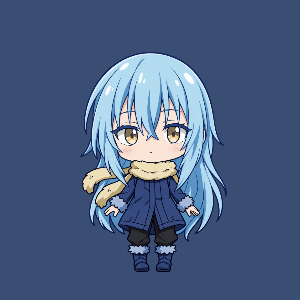 Idle (blinks, breath) | 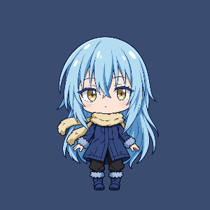 Talk (lip sync) | 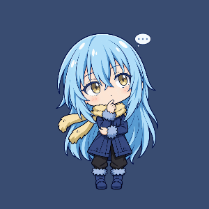 Think | 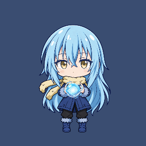 Analyse (working) |
| 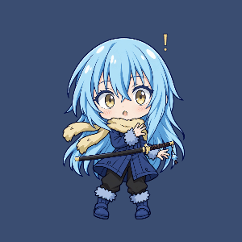 Notice (alert) | 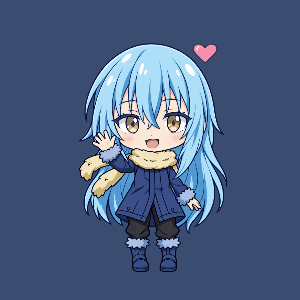 Wave |  Happy (Cheer) | 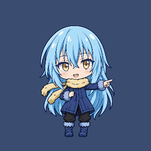 Look around |
| 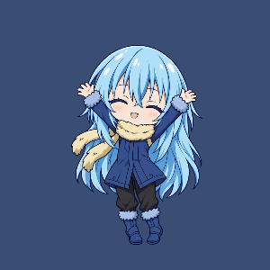 Stretch |  DanceExcited |  DanceVibe | 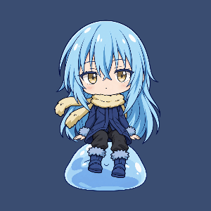 Sit (on the slime) |
|  Sleep | 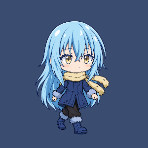 Walk | 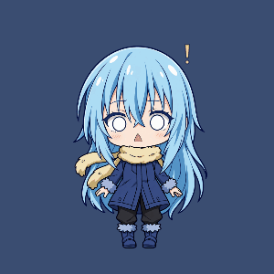 Surprised | 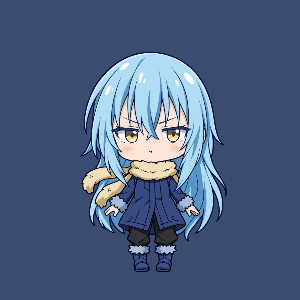 Pout |
| 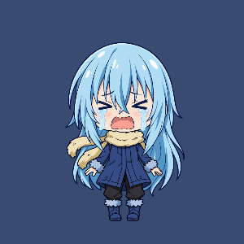 Upset (crying) | 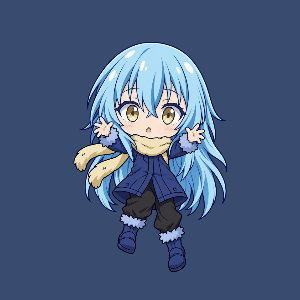 Held (with lean) | 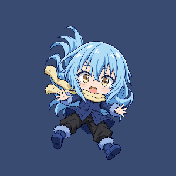 Fall | 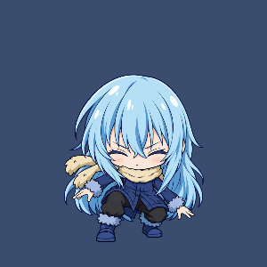 Land (squash) |

## The discarded code-drawn chibi
`overlay/chibi_overlay/vector/` holds an earlier attempt that drew the chibi from paths in code. Saber discarded it: it's not her look, and no outfit uses it. The code is still behind the `vector:` rig path. The casual-coat art above is her chibi.

## Live2D rigs
The original plan (`docs/character.md` → Making the art and rigs) was two Live2D Cubism rigs run by live2d-py: a chibi that fits Cubism FREE (one 2048 px texture, ≤ 100 meshes) and a 7-head serious rig. The pipeline still works and is kept:
- A `.model3.json` rig path loads it through live2d-py. Its motions, expressions (`.exp3.json`) and physics (`physics3.json`) come from the model. The standard parameters (`ParamAngleX/Y/Z`, `ParamBodyAngleX`, `ParamEyeL/ROpen`, `ParamMouthOpenY`, `ParamBreath`) take the stage's procedural params and lip sync.
- live2d-py ignores `Meta.Loop`, so `Puppet` restarts the motion groups whose first motion3 sets it (`motion.looping_groups`).
- The click-through test reads the alpha of her pixels from the last frame (`glReadPixels`), so every 2D rig kind gets the same pixel-exact hit test. The 3D body uses a hull from Godot instead.
- `docs/rig-checklist.md` lists the PSD layers, parameters and motion groups for her own chibi. `overlay/rigs/raphael_chibi.toml` maps her moods onto those names.

Rigs that have run in the overlay (the files stay outside git, in `ChibiAgent\rigs\`):
- **Haru / Mao:** Live2D's free samples. They were placeholders for the chibi and serious forms (`haru.toml`, `mao.toml`).
- **White robe chibi:** Saber's own rig (v20, then v21 with a more readable face, 2026-10-19), at `height_dip` 320.
- **ANIYA:** DG_studio's free model (personal use only), translated and prepared by `tools/prepare_aniya.py`. `aniya_chibi.toml` maps the app's nine expressions onto its reaction faces.

None of them is in the default config since v0.1.1. Saber's machine still has the files, and an `[overlay.outfits.<name>]` entry brings any of them back.

## Outfits, moods and the wheel on the 2D body
- **Outfits:** [Forms, bodies and outfits](forms-and-bodies.md).
- **How moods are chosen** (brain, pokes, idle life, sleep, music): [Interactions](interactions.md).
- **The pose wheel** works on both bodies. Its icons are silhouettes of the 3D body.
