# The 3D avatar

[Wiki home](README.md) · [2D avatar](2d-avatar.md) · [Forms, bodies and outfits](forms-and-bodies.md) · [Interactions](interactions.md)

Raphael's 3D body is a full-size anime figure, 520 DIPs tall (`height_dip` in `overlay/rigs/raphael_3d.toml`), drawn by **Godot 4.7** from a VRM model. She's one of her two bodies: she shows one at a time ([Forms, bodies and outfits](forms-and-bodies.md)). In the default `chibi` outfit the 3D Raphael is also her **serious form**.

The full user and developer reference is `overlay3d/README.md`. This page summarises it and adds the GIFs.

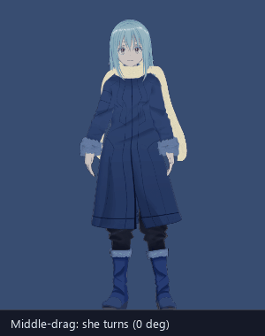

## The renderer, driven by the overlay
The Python overlay stays her only link to the agent. It keeps everything that isn't drawing: brain and physics, input (poke, long press, drag, throw), her panels (speech, HUD, confirm buttons, thinking core), the tray, fullscreen hiding and the 30 fps cap on battery. Godot only draws her.

```
agent ──WS (unchanged)── overlay (Python, Qt)                     Godot overlay3d (renderer)
                          Stage.tick → GodotModel.Update  ──TCP──▶  clip, expression, params, gaze
                          hit test (point in her hull)    ◀──TCP──  hull of her bones, window handle
```

- **A body kind like any other:** an outfit whose rig path is `godot:<overlay3d dir>`, or `godot:<dir>#<file>.vrm` for another model in `models/`. `GodotModel` (`overlay/chibi_overlay/godot3d.py`) answers the same live2d-py calls `Puppet` makes on a Live2D model.
- **Starting it:** the overlay starts Godot (`[overlay] godot_exe`; the app ships `godot\Godot_v4.7.2-stable_win64.exe`) with `--renderer=PORT --token=T`. Godot connects back over local TCP and sends the random token in its first line. If the project has no `.godot/` cache, or a dropped-in VRM has no `.import`, `godot3d.needs_import` runs `godot --headless --import` once first.
- **The link:** one JSON object per line. Each tick the overlay sends her feet and height in window px, her velocity, the clip and expression names, the Live2D-style params (mouth, body and head angles, eyes), the gaze point, her yaw (middle-drag) and the headset state. Godot sends back the hull of her bones (for hit tests) and its window handle.
- **The window belongs to the overlay:**
  - it covers her monitor, 1 px short at the bottom, directly under the overlay window;
  - it's permanently click-through (`WS_EX_LAYERED | WS_EX_TRANSPARENT`), never takes focus and has no taskbar button;
  - it's 1 px short because a window covering the whole monitor counts as a fullscreen game to any fullscreen watcher, and the agent would free its VRAM;
  - clicks keep landing on the overlay window, which asks `GodotModel.hit()`: a point-in-hull test against the hull Godot sent with the last frame.
- **Smooth movement:** Godot draws on its own vsync, out of step with the overlay's ticks, so it carries her on at the frame's velocity (up to 50 ms) instead of stepping unevenly.
- **Lifetime:**
  - one renderer per overlay, shared by every puppet using it;
  - switching to 2D hides its window at once and ends it 0.5 s later;
  - it sits in a kill-on-close job, so it never outlives the overlay, even after a crash;
  - it quits by itself if the link drops.
- **If it can't start** (no exe, or no hello within 30 s): the overlay goes back to the 2D body and tells the agent through `outfit_state`.
- **Log:** `%LOCALAPPDATA%\ChibiAgent\logs\godot3d.log`.

## The models
| Outfit | File | Look |
|---|---|---|
| **Raphael** | `overlay3d/models/raphael.vrm` (was `raphael_teen_ruby.vrm`) | ruby-red eyes; her serious form in the `chibi` outfit |
| **Rimuru** | `overlay3d/models/rimuru.vrm` (was `raphael_teen.vrm`) | the base look |

Both are rurune's "Rimuru Tempest (fanmodel)" with Saber's edits, exported from Saber's Blender master (`D:\Character Design\output\3d\teen\vrm-appearance\…\Raphael_VRM_Appearance_v01.blend`) by `overlay3d/tools/export_vrm.py`. Their VRM metadata says **Redistribution_Prohibited** and **commercial use: Disallow**, so:
- `models/` and every `*.vrm` stay out of git, and `packaging\build.ps1` refuses to ship them;
- a fresh install has no 3D model and stays in the chibi form until one is added (`docs/add-3d-model.md`);
- unlike the 2D art, they can't go on the portfolio.

Any humanoid VRM 0.x or 1.0 works in their place. Switching between 3D variants restarts the renderer (about 3 s).

**What doesn't carry over from Blender:** the ragdoll, the coat's cloth simulation and the volume-preserving skinning. Here the coat follows the skeleton, and the hair and scarf use the VRM's own spring bones. The scarf's unlit Blender shader exports with no alpha, so `raphael.gd` (`_fix_alpha`) rebuilds it at load as an unlit, alpha-cut texture.

## Motions: Mixamo first, keyed clips as fallback
- **Slots:** each clip slot (Idle, Talk, Think, Wave…) is named in `overlay3d/clip_sources.cfg`, which lists the Mixamo FBX takes that play it. The takes live in `overlay3d/anims/mixamo/`, outside git.
- **Baking:** `mixamo.gd` retargets each take onto her skeleton at renderer start (about 1 s for all of them). It applies each bone's world-space change from the T-pose to her rest pose, then converts that to her local rotations. Only the hips' height carries over.
- **Variety:** a slot with several takes plays a random one each time it starts or loops (Idle, Talk, Think, Pout, Stretch). Sleep picks one take per sleep (`vary=false`).
- **Per-take tuning:** `start` (seconds into the take), `lift` (hips up or down), `keep_height`, `loop=false`, and per-file settings for the sleep poses.
- **Fallback:** a slot without takes plays its keyed clip from `clips.gd` (poses in degrees per bone, applied Z, Y, then X; the right side mirrors the left). `--source=keyed` turns Mixamo off for comparison.
- **Blending:** `raphael.gd` crossfades between clips over 0.25 s (quaternion slerp) and sets only the humanoid bones. On top it layers breath, blinks, gaze, the overlay's params and an **expression mixer** that reads godot-vrm's per-expression blend-shape tracks, so a mood, a blink and a mouth shape can mix.
- **Coat clearance:** `coat_clearance.gd` keeps her hands out of the coat. It fits three hidden convex volumes to the torso and hem, checks 48 spherical probes on the forearms, palms and fingers, and corrects only the upper-arm, lower-arm and wrist rotations, after the clip and before the spring bones (`--coat-clearance=off` to compare).

### Mood → clip → Mixamo take
| Mood or moment | Slot | Mixamo take(s) | Expression |
|---|---|---|---|
| idle, cursor far, moment | Idle | Idle-breathing, weight shift | neutral |
| cursor near | Idle | (same) | happy |
| talking | Talk | Talking-normal, happy hand gesture, acknowledging, lengthy head nod, head nod yes | neutral |
| answering: the first 2.7 s | AnswerPoint | Pointing | neutral |
| answering: the rest | Answer | Talking-normal | neutral |
| thinking | Think | Thinking, thoughtful head shake | neutral |
| working | Analyse | Pointing | neutral |
| alert, moment curious | Notice | Hand Raising | surprised / neutral |
| happy (Cheer) | Happy | Happy | happy |
| surprised | Surprised | Reacting-surprise | surprised |
| pout | Pout | Angry, annoyed head shake | angry |
| crying | Upset | Crying | sad |
| held (at the waist or above) | Held | Hanging Idle | surprised |
| held_low (below the waist) | Carried | Being Carried | surprised |
| falling | Fall | (keyed) | surprised |
| falling_flat (dropped while carried) | FallFlat | Falling-facedown | surprised |
| soft landing | Land | Falling To Landing | happy |
| hard landing from high | HardLand | Hard Landing, from 0.6 s | sad |
| hard landing, flat | FlatImpact | Falling Flat Impact, from 0.4 s | sad |
| getting up | GetUp | Hard Landing, from 1.4 s | neutral |
| dizzy | Dizzy | Dizzy Idle | sad |
| walking, wander | Walk | Walking | neutral |
| sleeping | Sleep | Female Laying Pose, Female Laying Pose - 2, Sleeping Idle | relaxed |
| moment sit | Sit | Sitting Idle (hips held at the beanbag, `lift=-0.415`) | relaxed |
| dancing (slow music) | DanceVibe | Listening To Music | smile |
| dancing_excited (EDM, or Dance on the wheel) | DanceExcited | Snake Hip Hop Dance | smile |
| moment look around | LookAround | Looking Around | neutral |
| moment stretch | Stretch | stretch, Neck Stretching | relaxed |
| moment wave | Wave | Waving | happy |

**Expressions** are the VRM's own (neutral, happy, angry, sad, relaxed, surprised) plus **smile** (`raphael.gd` `_add_smile`): the Joy brows and mouth with her eyes open, because VRoid's `happy` (Fcl_ALL_Joy) shuts her eyes. Both dances use `smile`. The overlay's dance sway isn't layered over a Mixamo dance take, only over the keyed fallback dances.

## Props
`props.gd` shows each prop only while it's used, popping it in and out over 0.2 s. Clicks pass through props: the hull is her bones only.
- **Headset** (follows her Head bone):
  - **with the mic** through a spoken conversation, from push-to-talk until her reply has been spoken;
  - **without the mic** while media plays;
  - **off** for everything else (voice reactions, wheel poses, briefings, typed chat), 5 s after the conversation or the music ends.
- **Slime beanbag** under her while she sits. It squashes over 0.4 s as she settles.
- **Futon (v02)** under her while she sleeps, laid feet-to-head with her head on the pillow. Each sleep take has its own blanket shape key (`Cover_Front`, `Cover_SitUp`, `Cover_Side`) and lift. It pops out when she wakes. `SHOW_FUTON = false` brings back floor sleep.
- **Colours:** the props were made under Blender's soft studio lights. Here they get their own fill and bounce lights on render layer 2, which only props are on, and are desaturated to match. She isn't lit by those lights.

## Her clips (3D)
Each GIF is one slot played by the Godot preview (`--clip`, `--expr`) with the Raphael model, recorded with Godot's Movie Maker.

| | | | |
|:-:|:-:|:-:|:-:|
| <br>Idle | 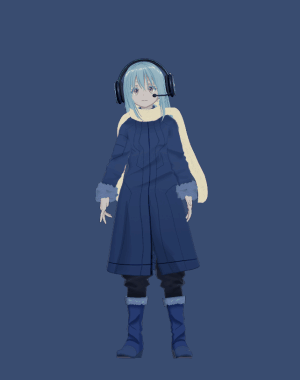<br>Talk (headset on) | 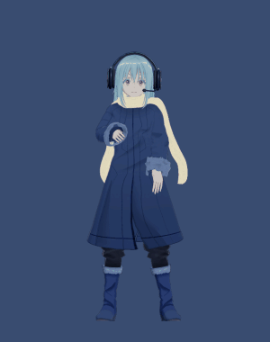<br>AnswerPoint | 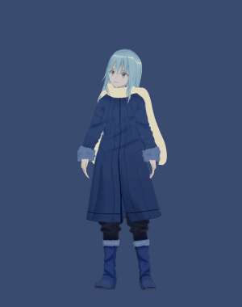<br>Think |
| 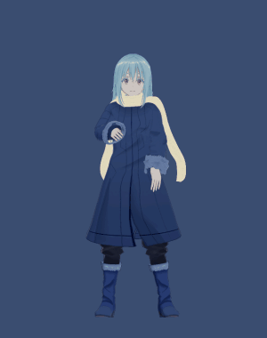<br>Analyse | 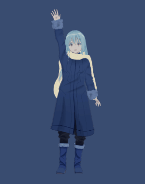<br>Notice | 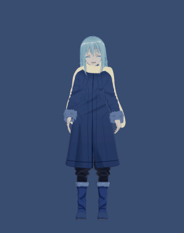<br>Wave | 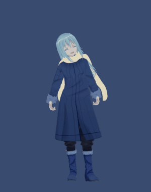<br>Happy (Cheer) |
| 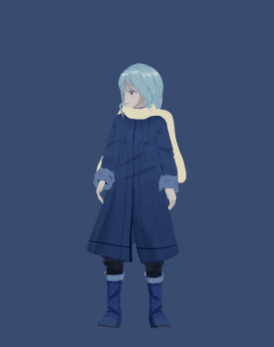<br>Look around | 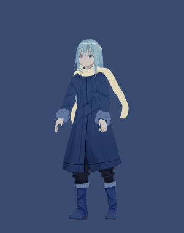<br>Stretch | 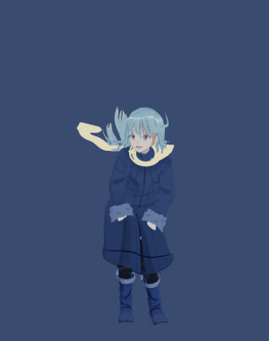<br>DanceExcited | 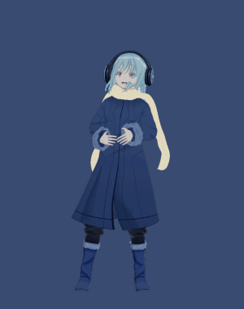<br>DanceVibe |
| 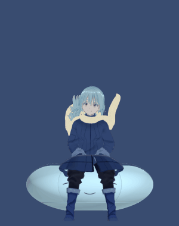<br>Sit (beanbag) | 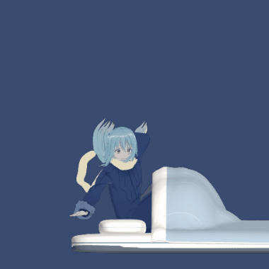<br>Sleep (futon) | 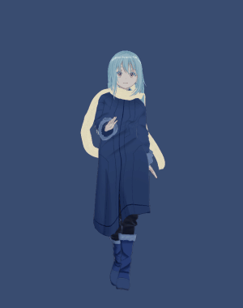<br>Walk | 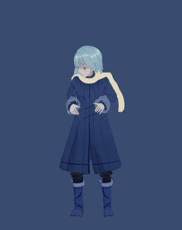<br>Surprised |
| 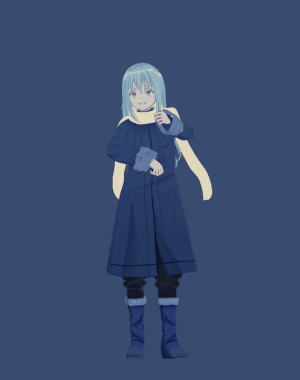<br>Pout | 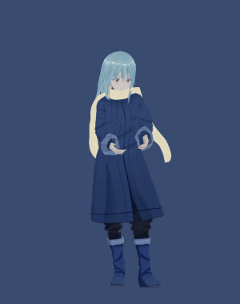<br>Upset | 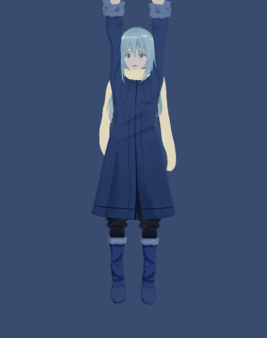<br>Held | 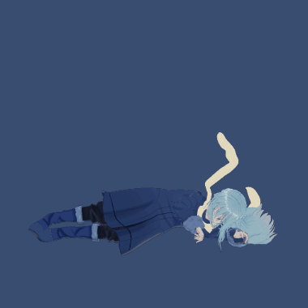<br>Carried |
| 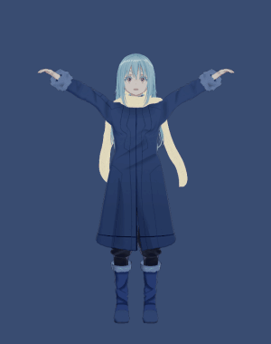<br>Fall | 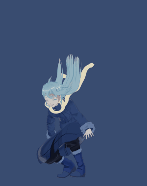<br>Land | 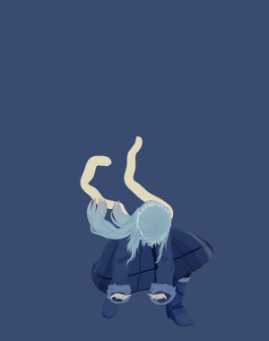<br>HardLand | 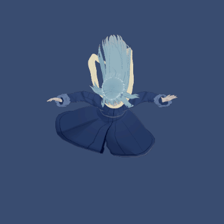<br>FallFlat |
| 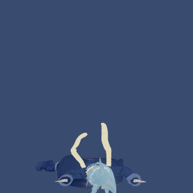<br>FlatImpact | 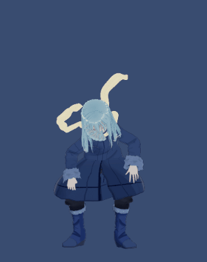<br>GetUp | | |

## Turning, pace and placement
- **Facing:** she turns 70° toward where she walks, and at rest faces the way Saber last turned her.
- **Middle-drag** on her turns her: 0.5° per px (`stage.py` `ROTATE_DEG_PER_PX`). The turn lasts until restart. The 2D art ignores it.
- **Walking pace:** `walk_speed = 0.5` heights per second, 260 px/s at 520 px. Customize → Look → Walking speed sets px/s per outfit.
- **Size:** `height_dip` 520; Customize → Look → Height overrides it.

## Preview and test flags
```bash
Godot_v4.7.2-stable_win64.exe --path overlay3d -- --model=res://models/raphael.vrm --clip=Wave --expr=happy --seconds=2 --screenshot=wave.png
```
`--clip`, `--take` (one Mixamo take of the slot), `--expr`, `--gaze=X,Y`, `--turn=DEG`, `--listen=S` (headset), `--height=PX`, `--offscreen`, `--seconds=S`, `--screenshot=PATH`, `--pose-report`, `--source=keyed`, `--coat-clearance=off`. From the overlay: `python -m chibi_overlay --outfit raphael`, `--debug-throw=VX,VY`, `--debug-switch=S`. A test overlay needs its own empty `APPDATA` and `LOCALAPPDATA`, or it knocks the running overlay off the agent.

## Quality and budgets
- `[overlay] render_scale` (supersampling, 1.0–2.0) and `msaa` (0/2/4/8). **Default 2.0 and 2×**: at 1.0 her hair breaks into jagged noise and her mouth is a single harsh line. Godot alone then uses about 580 MiB of GPU memory, within Saber's 800 MB limit for her render.
- **Measured** (RTX 4060 Laptop, Compatibility renderer, 2026-10-25):
  - CPU: overlay about 17 % of one core, Godot 33–37 %;
  - memory: overlay about 207 MB, Godot about 204 MB;
  - renderer start: about 3 s, with about 1 s of Mixamo baking.
- She renders on whichever GPU drives the screen she's on (the 4060 here).
