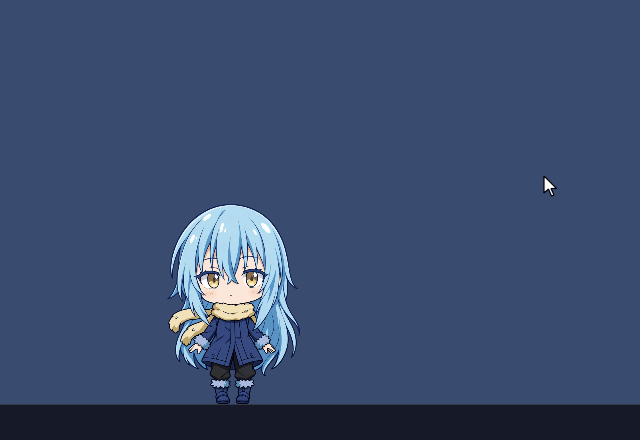
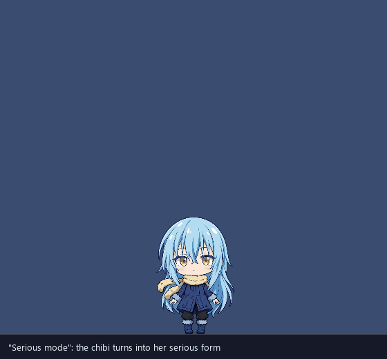
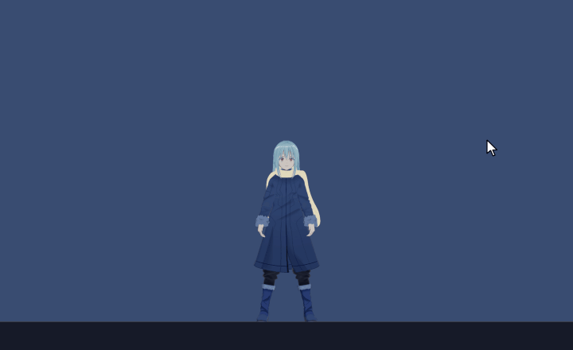

# Raphael's avatars: wiki

How Raphael looks and moves on the desktop: her 2D and 3D bodies, how the overlay drives them, and what Saber can do to her. The GIFs are offscreen renders made with the overlay's own drawing code and Godot, not screen captures ([how they were made](making-the-gifs.md)).

## Pages
| Page | What it covers |
|---|---|
| [The 2D avatar](2d-avatar.md) | Her chibi: Saber's casual-coat art from `svg-rig`, driven as a sprite pack; the Live2D rigs, rig maps, moods and expressions, with a GIF of each pose. |
| [The 3D avatar](3d-avatar.md) | Her full-size 3D body: the Godot 4.7 renderer the overlay drives (`overlay3d/`), the VRMs, Mixamo motions, expressions, props, render quality and budgets, with a GIF of each clip. |
| [Forms, bodies and outfits](forms-and-bodies.md) | Chibi and serious forms, 2D and 3D bodies, outfits, the tray's 2D/3D switch and the transform between forms. |
| [Interactions](interactions.md) | What Saber can do to her (poke, hold, drag, throw, Alt-drag, middle-drag, right-click wheel, the cursor) and how she answers: motions, voice reaction clips, sounds, the speech panel, task HUD and confirm card. |
| [Making the GIFs](making-the-gifs.md) | How the GIFs were rendered offscreen, and how to make them again. |

## Where things live
| Part | Code | Data (outside git) |
|---|---|---|
| Brain, physics, input | `overlay/chibi_overlay/body/`, `stage.py`, `window.py` | |
| 2D chibi (casual-coat art) | `overlay/chibi_overlay/sprites.py`, `overlay/rigs/raphael_sprites.toml` | `assets/chibi/casual-coat/v01/` (in the deployed app) |
| Live2D rigs | `overlay/chibi_overlay/puppet.py`, `overlay/rigs/{raphael_chibi,aniya_chibi,haru,mao}.toml` | `ChibiAgent\rigs\` |
| 3D body | `overlay/chibi_overlay/godot3d.py`, `overlay3d/`, `overlay/rigs/raphael_3d.toml` | `overlay3d/models/*.vrm`, `overlay3d/anims/mixamo/` |
| Pose wheel | `overlay/chibi_overlay/wheel.py`, `overlay/icons/wheel/` | |
| Panels and core | `overlay/chibi_overlay/hud.py`, `core_fx.py` | fonts in `ChibiAgent\fonts` |
| Voice reactions | `shared/chibi_shared/reactions.py`, `agent/chibi_agent/reactions.py` | clip cache in `%LOCALAPPDATA%\ChibiAgent\clips` |
| UI sounds | `overlay/chibi_overlay/sounds.py` | `[overlay] sounds_dir` |

The sources of truth stay `docs/character.md` (her design and the mood table), `docs/architecture.md` (overlay internals) and `overlay3d/README.md` (the 3D body). These pages pull them together and add the details from the code.

## Licences, in short
- The 3D models are rurune's "Rimuru Tempest (fanmodel)" with Saber's edits: personal use only, no redistribution, no commercial use. The VRMs never go into git or a release. This wiki shows them in GIFs because Saber decided to (2026-10-27).
- Mixamo takes are Adobe content: fine to use here, but never committed or shipped as raw files.
- Her 2D art and rigs may be shown on Saber's portfolio. Her cloned voice may not, so the GIFs are silent and the voice lines appear only as text.
