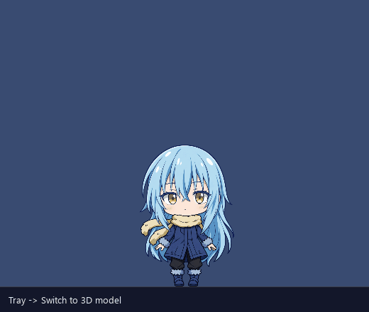

# Forms, bodies and outfits

[Wiki home](README.md) · [2D avatar](2d-avatar.md) · [3D avatar](3d-avatar.md) · [Interactions](interactions.md)

Three ideas, often mixed up:
- **Form:** *chibi* (idle and chat) or *serious* (work, alerts, on command). Every outfit has one model per form.
- **Body:** *2D* (the casual-coat art, or a Live2D rig) or *3D* (the Godot renderer). An outfit's body is whatever its chibi rig is.
- **Outfit:** a named pair of models, `[overlay.outfits.<name>]` in `config.toml`, each with `chibi_rig` / `serious_rig` and their rig maps.

## The shipped outfits (v0.1.1)
| Outfit | Chibi form | Serious form | Body |
|---|---|---|---|
| `chibi` (the start outfit) | the casual-coat art (sprite pack) | the 3D Raphael (`godot:overlay3d#raphael.vrm`) | 2D |
| `raphael` | the 3D Raphael | the same model | 3D |
| `rimuru` | the 3D Rimuru | the same model | 3D |

`[overlay] bodies = { 2d = "chibi", 3d = "raphael" }` says which outfit each body wears when Saber switches.

- **Missing models:** no VRM ships, so `outfits.usable` drops an outfit whose chibi model is missing, and keeps one whose serious model is missing in its chibi form only (`Outfit.chibi_only`). A fresh install is the 2D chibi with no serious form.
- **Old names:** saved Customize settings under casual_coat, teen_3d and teen_3d_ruby carry over (`character.RENAMED`).
- **Mixed bodies:** in the `chibi` outfit the chibi puppet is the sprite pack and the serious puppet is the Godot body. `window._drawn_body_only` shows the Godot window only while she's drawn in that form.

## Switching body: tray → Switch to 3D model / Switch to 2D art

- **Where:** the tray item's label follows the current body ("Switch to 2D art" while she's 3D). It's greyed out when there's no outfit for the other body. Customize → Look → Body does the same.
- **Which outfit:** `Stage.switch_body` wears the last outfit of the other body worn this session (for example, back to the Rimuru variant), else `[overlay] bodies`, else the first outfit of that body.
- **Remembered:** the choice is saved as her outfit in `character.toml`, so she starts in it next time.
- **How it looks:** the same puff as an outfit change, with no change of form (below).
- **If the 3D renderer can't start:** she's put straight back in the 2D body (`Stage.body_failed`) and the agent hears about it in `outfit_state`.

## Changing outfit: tray → Outfit
- **Where:** tray → Outfit lists every usable outfit, with a tick on the current one. The agent can also send an `outfit` message (voice still needs a confirmed tool).
- **Checks first:** `Stage.request_outfit` checks the name, the model files and the rig maps before anything changes. A refusal goes back as `outfit_state ok=false`, so the windows never try to load a broken model.
- **The puff:** the transform particles (140 cyan and gold glyphs spiralling up, 0.6 s) play without a change of form. Halfway through, `_wear` swaps the maps and model paths and bumps `outfit_gen`, and each window reloads both puppets in its GL context and measures them again.
- **What stays:** brain, physics, form and facing are untouched.
- **Switching between two 3D outfits** restarts the renderer (about 3 s).

## Transforming between forms

**What triggers it (since v0.1.1, Saber, 2026-10-27):** she doesn't change form by herself.
- "Serious mode" and "chibi mode" send a sticky `form` request, and she stays in that form until asked again.
- Work, briefings, confirms and alerts play their motions in her current form. The task card and the confirm buttons show beside the chibi too (`Stage.panels_on_chibi`).
- An outfit whose two forms are one model (the 3D Raphael and Rimuru) never transforms: it would only resize her.
- `[overlay] auto_serious = true` brings back the old behaviour: the serious form comes for working and alert moods and for a confirm, and stays 10 s after the work ends (`SERIOUS_HOLD_S`).
- `[overlay] chibi_only = true` keeps her in the chibi form whatever happens.

**How it plays** (`stage.py` `_start_transform`, `_step_transform`; `hud.py` `_particles`):
1. 140 particles start around her body, a third of them gold and the rest cyan. They rise at 80–260 px/s and weave sideways as they go.
2. At 0.3 s (halfway) the form switches. For 0.16 s around that point neither form is drawn, only the particles.
3. The particles fade in, then out, over the 0.6 s.

She never transforms while she's being dragged, and a pending outfit change rides along with a transform.

The design brief (`docs/character.md` → Transform) also asks for the halo to expand, the eyes to light up and a chime with "Confirmed."; these aren't built yet.

## Size, height and placement
- **Height:** each rig map sets `height_dip`: 320 for the sprite chibi, 520 for the 3D body. Customize → Look → Height overrides it per outfit.
- **Measuring:** each window measures the drawn model once (`Geom.measure`, from the alpha bounding box) and places her by her feet.
- **Home spot:** she lives at her home spot on the taskbar: 12 % in from the right edge of the primary monitor, unless Saber has Alt-dragged her somewhere else ([Interactions](interactions.md)).
