# Interactions

[Wiki home](README.md) · [2D avatar](2d-avatar.md) · [3D avatar](3d-avatar.md) · [Forms, bodies and outfits](forms-and-bodies.md)

What Saber can do to Raphael, and how she answers. Input, the brain and physics live in the Python overlay, so everything here works the same on the 2D and 3D bodies unless a section says otherwise. Each answer has up to three parts:
- **a motion:** a brain mood → the rig map's clip and expression;
- **a voice reaction:** a short pre-rendered line in her voice (the GIFs are silent; the lines are listed under [Voice reactions](#voice-reactions));
- **a sound or panel:** UI sounds, the speech panel, the thinking core, the task card or confirm buttons.

## At a glance
| Saber does | She does | Brain mood | Voice reaction |
|---|---|---|---|
| Click her once | starts, surprised (0.9 s) | surprised | `poke` |
| Click her 3 times within 2 s | pouts (2.2 s) | pout | `pout` |
| Click her 5 times within 2 s | cries (3 s) | crying | `cry` |
| Hold the button on her for 0.6 s | happy (2 s) | happy | `giggle` |
| Drag her | hangs from the cursor (3D: hangs, or is carried flat if grabbed below the waist) | held | `held` |
| Let go slowly | falls | falling → landing | `drop`, then `soft_landing` or `hard_landing` |
| Let go fast (a throw) | flies, bounces, lands and cries | falling → crying | `drop`, `cry` |
| Alt-drag her and let go | is put down there, and that spot becomes her home | held → falling → landing | as a drop |
| Middle-drag her (3D only) | turns about her vertical axis | (unchanged) | none |
| Right-click her | opens the pose wheel | (unchanged) | none |
| Pick a pose on the wheel | plays it | the pose's mood | always speaks the pose's line |
| Rest the cursor near her | smiles once (2.5 s) | cursor near | none |
| Click anywhere | she looks there for a few seconds | (unchanged) | none |
| Click her while she sleeps | wakes with a start | surprised | `wake` |
| Talk to her (push-to-talk) | listens, thinks, answers | thinking → talking | (her answer) |

## Clicking her: pokes
 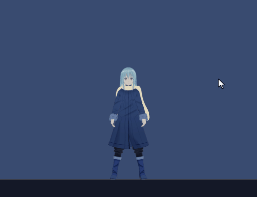

- **What counts as a poke:** a press and release on her without moving more than 6 px (`DRAG_PX`) and without holding 0.6 s.
- **How pokes add up:** `Brain.poke` keeps the pokes of the last 2 s (`POKE_WINDOW_MS`):
  - 1 → **surprised** for 0.9 s;
  - 3 → **pout** for 2.2 s;
  - 5 → **crying** for 3 s.
  While she's sulking, more pokes only escalate; a single poke doesn't calm her.
- **Ignored** while she's held or falling.
- **Waking her:** a poke on a sleeping Raphael wakes her with a start (surprised), and she says a `wake` line.
- **Clicks on her panels** (speech, HUD) are swallowed and never poke her.

## Holding her: the long press
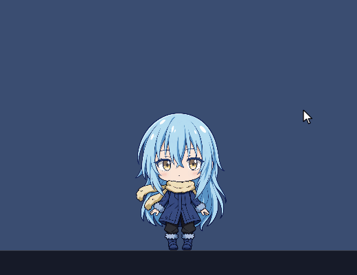

Hold the left button on her for 0.6 s (`LONG_PRESS_S`) without moving: she turns **happy** for 2 s, the poke count resets, and she giggles ("Hee hee." / "He he, that tickles.").
- **Voice:** the giggle moves her mouth without switching her to talking (`REACT_LIP_S`).
- **Not the agent's happy:** a `happy` the agent asks for stays quiet.

## Dragging, dropping and throwing
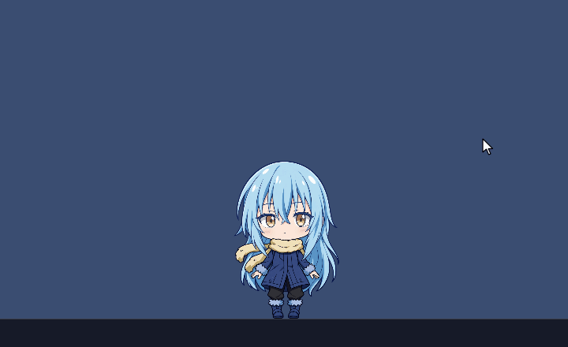 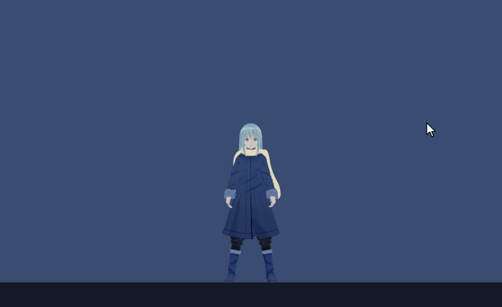

- **Picking her up:**
  - A press that moves more than 6 px starts a drag. The brain goes to **held**, she follows the cursor at the point where she was grabbed, and the agent gets a `hold` touch.
  - **Leaning:** while held, she leans against the drag (`ParamBodyAngleX`, up to ±10°, from the last 0.1 s of cursor movement).
  - **The 3D body has two holds:** grabbed at the waist or above, she hangs (Mixamo "Hanging Idle"); grabbed below half her height (`GRAB_LOW`), she's carried flat ("Being Carried"). Rigs without a `held_low` clip, like the 2D art, always hang.
- **Letting go:**
  - **The throw:** her release velocity is the cursor's movement over the last 0.1 s, capped at 4200 px/s. Faster than 1500 px/s (`THROW_SPEED`) counts as thrown.
  - **Physics** (`body/physics.py`, a port of Saber-Theme's `MascotPhysics`): gravity 2600 px/s², walls bounce at 0.55, the floor at 0.32 with 0.6 friction, and she stands once a bounce is slower than 260 px/s. All speeds are at 96 dpi, multiplied by the monitor's scale.
  - **Floor and walls:** the floor is the taskbar top, or the focused window's title-bar top. The walls are the monitor edges, so she can fly from one monitor to the next where they touch. The ceiling stops her head.
- **Landing** (`Brain.land`; Saber's rules of 2026-10-26; no dizziness after falls any more):
  - **Thrown, or slammed into a screen edge faster than 900 px/s (`WALL_HURT`):** she cries for 3 s.
  - **Dropped from more than half the screen's height (`HIGH_DROP`):** a hard landing. The 3D body lands feet first with "Hard Landing" from 0.6 s, 2.1 s back to standing.
  - **Anything lower:** a soft landing (0.6 s; 2D squash, 3D "Falling To Landing"), with a happy face.
- **Requests wait:** while she's held, falling or in a hard landing, the agent's mood requests are refused and wait until she has landed.

 

**Dropped while carried (3D only):** she falls face down ("Falling-facedown"), hits the floor flat ("Falling Flat Impact"), lies there for 1.6 s (`FLAT_IMPACT_S`), then gets up (the end of "Hard Landing"). The whole hard landing lasts 2.7 s, however fast she fell, with no tears.

**Alt-drag: setting her home.** Hold Alt while dragging her and let go: she's put down, not thrown (zero velocity). The taskbar spot below her becomes her home, saved as `behaviour.home_x` / `home_y` in `character.toml`. If that spot is no longer on a screen, she falls back to the default: 12 % in from the right of the primary monitor.

## Walking home and wandering
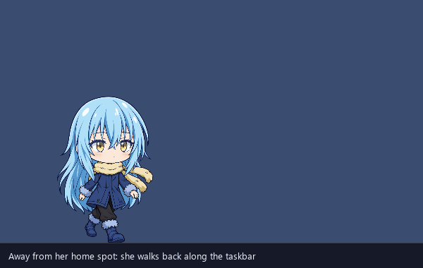 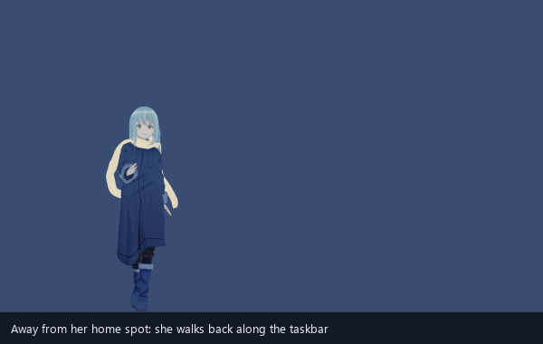

- **Walking home:** when she's more than 30 px from her home spot (after a throw, say) and idle, she walks back and faces the way she goes.
  - **2D pace:** 90 px/s.
  - **3D pace:** 0.5 of her height per second, 260 px/s at 520 px.
  - Customize → Look → Walking speed sets it per outfit.
- **Wandering:** a quarter of her idle moments are a stroll of 40–120 px to one side and back, at 60 px/s on the 2D body.

## The pose wheel (right-click)
 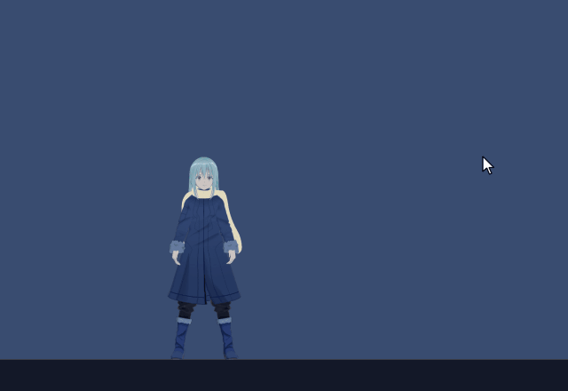

Right-click her for a game-style emote wheel beside her (`wheel.py`): eight frosted-glass segments, each with a white silhouette of her in that pose (`overlay/icons/wheel/`).
- **Hover:** lights a segment in teal, grows it and shows its name in bold under the ring ("POSES" when none is lit). Each new segment plays the `hover` sound.
- **Click a segment:** plays the pose with the `click` sound.
- **Closing it:** right-click her again, click its centre hole, or click anywhere else (`close` sound). It also closes 8 s after the cursor has left it. Opening it is silent (Saber's call).
- **Placement:** to her right at chest height, or to her left when the monitor ends. The ring sits 0.68 of her measured half width (`HUG`) plus 26 DIPs out from her centre: 128 DIPs across, with a 66 DIP hole.

| Pose (clockwise from the top) | Mood | How long | Voice |
|---|---|---|---|
| Wave | moment wave | 2.2 s | "Hello, Saber." |
| Cheer | happy | 2 s | "Wonderful." |
| Think | thinking | 6 s | "Let me think." |
| Look around | moment look around | 2.6 s | "Let me see." |
| Stretch | moment stretch | 1.8 s | "Mmh. Stretching." |
| Dance | dancing (the excited dance) | 15 s, no music needed | "Let's dance." |
| Sit | moment sit (2D: on the slime; 3D: on the beanbag) | 20 s | "I will sit for a while." |
| Sleep | sleeping (3D: on the futon) | until a poke, a drag or the agent wakes her | "Entering standby." / "Resting for a moment." |

**How a picked pose behaves** (`Brain.perform`):
- It's refused while she's held, falling or in a hard landing.
- It sets `performing`: the cursor-near rule, the music rules and idle moments don't cut it short, so Dance plays without music and Sleep isn't ended by the cursor resting near her.
- Any other transition ends it: a poke, a drag, or an agent mood.
- A picked pose counts as a touch and restarts the idle timers, except Sleep, which wants quiet.

## The cursor and her eyes
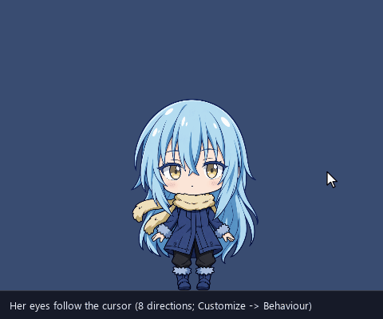

- **Gaze** (Customize → Behaviour → Eye follow):
  - **last click** (the default): she looks where Saber last clicked, with any button, anywhere, for a few seconds, then ahead;
  - **pointer:** she follows the cursor all the time;
  - **straight ahead.**
  She doesn't look anywhere while sleeping, dizzy or crying. The sprite chibi uses its eight gaze drawings; the 3D body turns her eyes and head.
- **Cursor near:** the cursor within 220 px of her chest makes her smile once (`cursor_near`, up to 2.5 s). She reacts again only after the cursor has left. She ignores the cursor while sulking, held, asleep or busy for the agent.
- **Cursor far:** a cursor far away on her monitor gets the `cursor_far` clip (her idle on both bodies now).

## Her idle life
 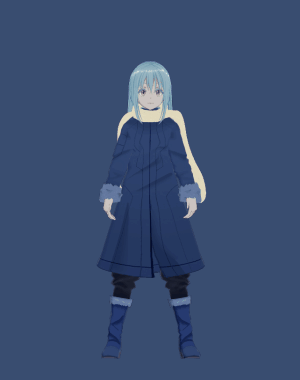

When nobody needs her (`Brain.tick`):
- **Idle moments:** every 8–20 s, one of look around, stretch, analyse, sit, wave, curious or thinking; or, a quarter of the time, a wander.
- **Sleep** after 60 s without a touch. A touch within the last second wakes her with a start.
- **Music:** while media plays she dances at her home spot (below). When it stops, she goes back to idle.
- **A new chat message:** she glances at her panel (the `curious` moment).
- **Tuning:** Customize → Behaviour sets the moment gap, the sleep delay and whether idle moments happen at all.

**Dancing to music** (`body/music.py`, `audio_sessions.py`):
- **What's playing:** Windows' media sessions (GSMTC) give the track. Players without one (VLC, MPC, mpv, PotPlayer, Windows Media Player…) are caught by their sound through the per-app audio meters.
- **Which dance:** EDM (whole-word keywords such as house, dubstep, nightcore or remix; known EDM artists; an electronic genre; Saber's extra words in Customize) gets the excited dance. Anything else gets the slow sway.
- **On the 3D body:** the slow sway is Mixamo "Listening To Music" with the headset on.

## Talking to her: thinking core, speech panel, HUD
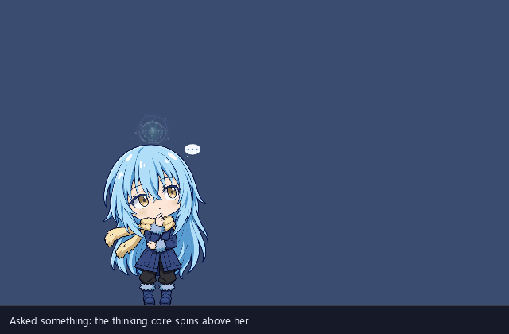 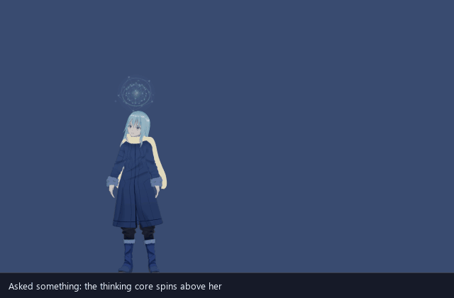

- **Listening** (push-to-talk held): her current pose, her eyes on the cursor. On the 3D body the headset comes on with the mic.
- **Thinking:** a geodesic wire core (`core_fx.py`) spins above her head while shards spiral in. The 2D chibi plays Think; the 3D body plays "Thinking".
- **Answering:**
  - **The core** grows and brightens with her voice level.
  - **Her words** go in a frosted liquid-glass panel beside her at face height (her right, or her left near the screen edge; a 20 % teal wash), in Electroharmonix, then OCR A Extended, then Consolas.
  - **Panel timing:** the text stays 6 s after it's complete, and 3 s after she stops speaking.
  - **The 3D body points first:** talking straight after thinking opens with AnswerPoint (Mixamo "Pointing", 2.7 s), then Answer ("Talking-normal"). Other talking uses the varied Talk takes.
- **Lip sync:** the voice process sends RMS levels at 60 Hz. The overlay smooths them (fast attack, slower release) into `ParamMouthOpenY`. That picks the sprite chibi's mouth state, a Live2D rig's mouth, or the 3D body's mouth shape.
- **Customize → Look:** sets the panel font and size ("Add font file…" copies a font into `[overlay] fonts_dir`).

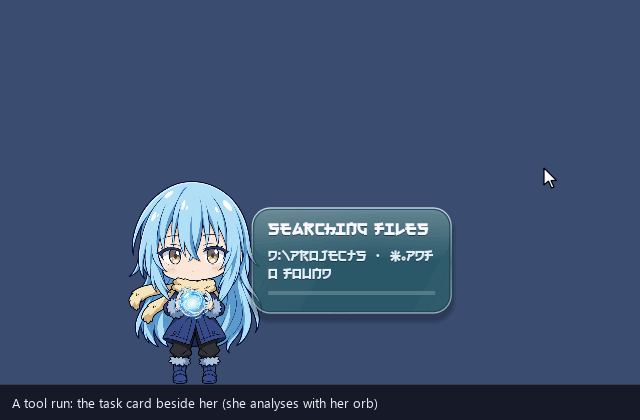

- **Working** (a tool run, file search or screen read): the `working` mood. The chibi analyses with her orb; the 3D body plays "Pointing". The **task card** (title, items, progress bar) shows in the same glass on the other side of her.
- **Confirm:** a side-effect tool asks first. The card reads "Confirm: 
", the detail and **Yes** / **No** (gold and grey). Click one (`click` sound), or answer by voice. With no answer in 60 s it counts as No.
- **Briefings** use the same card for their items. **Alerts** play Notice: the chibi holds her sword across her hands under a "!", the 3D body raises a hand.

## Voice reactions
Short in-character words, not gasps (F5 says words reliably). The lines are in `shared/chibi_shared/reactions.py`. The voice process pre-renders them into the clip cache in her current voice, in the background after the openers.

**How a reaction gets to her voice:**
1. The overlay turns a mood change into an event (`sounds.reaction_for`) and sends `React(event, picked)`.
2. The agent's `Reactor` (`agent/chibi_agent/reactions.py`) decides whether she speaks.
3. The voice process plays the chosen line from the cache only (`only_cached`). A reaction never synthesises.

**When she stays quiet:**
- when muted, in gaming mode, or while Saber is talking to her or she's answering;
- within 1.5 s of any reaction, or 4 s of the same one;
- for idle moments she starts by herself: they speak 25 % of the time, at most every 30 s. Poses picked on the wheel always speak.

**While a reaction plays:** it moves her mouth without switching her to talking, so a stretch or a sleep isn't interrupted. The thinking core stays hidden: it's her, not the agent answering.

| Event | When | Lines |
|---|---|---|
| poke | surprised by a click | "Hm?" · "Yes, Saber? What is it?" · "Is something needed?" |
| wake | poked awake | "I'm awake." · "Resuming." |
| pout | 3 pokes | "Saber, please stop." · "That is enough poking." |
| cry | 5 pokes, a throw or a wall hit | "That was uncalled for." · "Please be gentle, Saber." |
| giggle | long press | "Hee hee." · "He he, that tickles." |
| held | picked up | "Oh." · "Where are we going?" |
| drop | let go | "Ah." |
| soft_landing | a soft landing | "Landed." |
| hard_landing | a hard landing | "Ow." · "That was unnecessary." |
| sleep | falls asleep | "Entering standby." · "Resting for a moment." |
| stretch, wave, sit, look_around, dance | idle moments or wheel picks | "Mmh. Stretching." · "Hello, Saber." · "I will sit for a while." · "Let me see." · "Let's dance." |
| cheer, think | wheel picks only | "Wonderful." · "Let me think." |
| dizzy | (no longer reached: no dizziness after falls) | "Everything is spinning." · "Recalibrating balance." |

The voice is a personal-use F5 clone. The reference clips and the rendered lines never go into git and are never published, which is why no audio is attached here.

## UI sounds
Saber's own WAV files in `[overlay] sounds_dir`, outside git, played by the overlay (`sounds.py`) at `sfx_volume`. Tray → Sound effects turns them off.

| Sound | When |
|---|---|
| `startup` | she first appears |
| `appear` | she comes back from hiding (fullscreen apps or tray → Hide) |
| `hover` | each new segment lit on the pose wheel |
| `click` | a pose picked, or a confirm button |
| `close` | the wheel closed without a pick, or timed out |

## The tray
`tray.py`. The items that touch her body:
- **Hide / Show Raphael**
- **Mute voice:** also silences her reactions.
- **Sound effects**
- **Gaming mode:** frees GPU memory and silences her reactions.
- **Switch to 3D model / Switch to 2D art:** see [Forms, bodies and outfits](forms-and-bodies.md).
- **Outfit**
- **Customize Raphael…:** a live preview, with tabs for moods and idle moments, Look (outfit, height, walking pace, body, panel font), Behaviour (eye follow, blink, idle moments, sleep, effects, EDM words), Sequences (sprite frames, timing, props, seats) and Voice.
